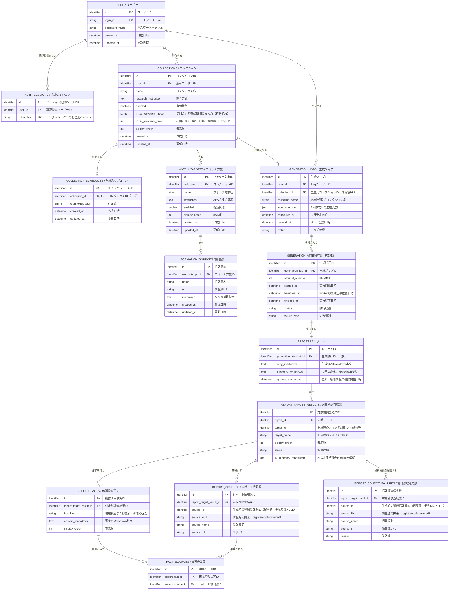

# WatchBrief DB設計

> [!NOTE]
> この文書はIssue #3で整理した論理スキーマ案を示す。初期DB製品はIssue #11でPostgreSQLに決定した。英語名は実装候補であり、バージョン、物理型、ORM、migration方式は今後確定する。

## 目的とドメインモデルとの関係

アプリの概念と業務ルールを、DBのテーブル、カラム、外部キー、制約、インデックスとしてどう保存・保護するかを示す。業務上の意味と状態遷移は[ドメインモデル](domain-model.md)、利用者向け仕様は[プロダクト仕様](product-definition.md)を参照する。

アプリのクラス・構造体とテーブルを1対1にすることは要求しない。例えば、事実が持つ出典の一覧は、DBでは `REPORT_SOURCES` と中間テーブル `FACT_SOURCES` で表す。ORMへのマッピングとアプリ側の型構成は実装時に決める。

## スキーマを確定する段階

- Issue #3：保存対象、テーブル案、関係、論理カラム、一意性、削除方針、初期インデックスの要件を整理する。
- 物理設計時：PostgreSQLと採用するDBアクセス方式に合わせ、物理型、文字数上限、NULL・CHECK制約、インデックス、ロック方式を具体化する。
- 実装時：migrationとしてレビュー・適用できる形にし、制約、トランザクション、主要クエリを検証する。migration方式自体は未決定である。

## 保存設計の前提と制約

- 初期DBはPostgreSQLとし、アプリと同じEC2に配置する。将来RDSへ分離する方針にIssue #11で合意し、初期からRDSを使う以前の決定は更新した。PostgreSQLのバージョンと将来の移行先エンジン（Auroraを含む比較）、サイズ、可用性構成、物理型、ORM、migration方式は未決定であり、論理スキーマは維持する。
- 初期PostgreSQLの正本データは、OS用とは別のDB用EBSに保存し、EC2削除時も保持する（`DeleteOnTermination=false`）。OS用・DB用とも東京リージョンのAWS管理KMS鍵 `aws/ebs` で暗号化する。容量、種類、ファイルシステム、保存場所、権限、マウント、保持後の管理・削除手順は未決定である。詳細は[システム設計](system-design.md#初期ストレージの方針)で扱う。
- 初期PostgreSQLはEC2内部からの接続に限定し、待受設定とSecurity Groupで外部からの直接接続を許可しない。具体的なアドレス・ポート・ソケット方式、DB認証、保存方法、DB管理操作の具体手順は今後設計する。管理接続は[システム設計](system-design.md#初期sshの接続元と認証)を参照する。将来RDSを使う場合も非公開とし、通常のDB接続元をアプリ実行環境に限定する。
- 予定された生成を `GenerationJob`、workerによる実際の1回の実行を `GenerationAttempt` として分ける。
- 待機中のJobにはAttemptが存在しない。実行を開始した場合は、成功・失敗にかかわらずAttemptを残す。
- 実行開始時はGenerationAttemptの作成とGenerationJobの `running` への変更を同じDBトランザクションで行い、片方だけを残さない。
- GenerationJobの状態は `queued`、`running`、`succeeded`、`failed` とする。
- GenerationAttemptの状態は `running`、`succeeded`、`failed` とし、待機状態は持たせない。
- Job・Attemptの画面表示は[プロダクト仕様](product-definition.md#レポート)を参照する。DBでは上記の内部状態を保存する。
- timeoutは独立した状態にせず、GenerationJobとGenerationAttemptを `failed` にした上で、GenerationAttemptの `failure_type` に `timeout` を記録する。
- 実行中のworkerはGenerationAttemptの `heartbeat_at` を定期的に更新する。別の監視処理が一定時間更新されていない `running` Attemptを検出した場合、JobとAttemptを同じDBトランザクションで `failed` にし、`failure_type` を `worker_interrupted`、`finished_at` を検出時刻とする。具体的な時間設定はIssue #7で決める。
- 停止判定後に遅れて元のworkerが戻った場合、Attemptが `running` であることを条件に状態を更新し、失敗確定済みのAttemptを成功へ戻したりReportを保存したりしない。
- GenerationAttemptからReportへの関係は0または1件とする。`succeeded` のAttemptには必ず1件、`failed` のAttemptには0件とし、DBでReportの `generation_attempt_id` を一意にして同じAttemptから複数のReportが保存されることを防ぐ。
- 成功時はReportと配下の構造化データ、GenerationAttemptの `succeeded`・`finished_at`、GenerationJobの `succeeded` を同じDBトランザクションで保存する。
- Report保存を含む成功トランザクションが失敗した場合は全体をロールバックし、別トランザクションでGenerationAttemptとGenerationJobを `failed`、`failure_type` を `persistence_error` として記録する。Report保存前に確定した既知の失敗も、AttemptとJobを同じトランザクションで失敗へ変更する。
- DB障害により失敗状態の記録もできない場合は、元の失敗と記録失敗をDB外のプロセスログへ残す。`running` のまま残ったAttemptはheartbeat監視で後から検出する。
- AIは完成MarkdownではなくMarkdown断片を含む構造化データを出力し、アプリが固定構成のMarkdown本文を組み立てる。組み立てた本文は `Report` の一部として構造化データと同じトランザクションでDBへ保存し、閲覧時に再生成しない。S3は本文の主保存先にはしない。
- Markdownの許可構文・表示処理は[プロダクト仕様](product-definition.md)を参照する。DBは検証済み構造化データと完成本文を保存する。
- 初期MVPでは自動retryを行わないため、1つのJobに対するAttemptは最大1件とする。将来retryを導入する場合は、同じJobにAttemptを追加できる関係を使う。`attempt_number` はJobごとに1から始め、DBで `generation_job_id` と `attempt_number` の組み合わせを一意にする。
- 初期MVPではGenerationJob、GenerationAttempt、Reportを削除しない。GenerationAttemptは必ず1つのGenerationJobを、Reportは必ず1つのGenerationAttemptを参照し、子がある親の削除は外部キーの `ON DELETE RESTRICT` で拒否する。Attemptがない `queued` Jobにも削除操作を用意しない。
- SchedulerはJob作成時点の生成入力を、GenerationJobの `input_snapshot` JSONカラムへ保存する。Jobとスナップショットを同じDBトランザクションで保存し、保存後は変更しない。workerは現在設定ではなくスナップショットを使う。
- `input_snapshot` には `schema_version`、調査方針、初回の更新確認期間の決め方、有効なWatchTargetのID・名前・補足指示・表示順、InformationSourceのID・名前・URL・補足指示を含める。日数指定の場合は指定日数も含める。JSON内のIDは履歴用の値であり、現在設定への外部キーにしない。cron式、認証情報、token、secretは含めず、Collection名はJobの `collection_name` を使う。
- AI出力は保存前に検証し、未検証の生レスポンスを保存しない。対象・出典との対応や必須内容の検証規則は[システム設計の生成フロー](system-design.md#レポート生成フロー)と[プロダクト仕様](product-definition.md)を参照する。
- CollectionをOFFにした後は、`queued` または `running` のJobがあってもWatchTarget、InformationSource、調査方針、CollectionScheduleを編集・削除できる。作成済みJobは `input_snapshot` を使い、現在設定の変更は後続Jobだけに反映する。Collection本体は、既決定どおり稼働中Jobがある間は削除できない。
- `queued` または `running` のGenerationJobがあるCollectionは削除できない。すべてのJobが `succeeded` または `failed` になった後はCollectionを物理削除できるが、GenerationJob、GenerationAttempt、Reportは保持する。GenerationJobの `collection_id` はNULLを許可し、Collection削除時は外部キーの `ON DELETE SET NULL` で参照だけを外す。
- 現在設定の親子関係にはDBの `ON DELETE CASCADE` を使う。Collection削除時はCollectionScheduleとWatchTargetを、WatchTarget削除時はInformationSourceを連鎖削除する。生成履歴であるGenerationJob、GenerationAttempt、ReportとReport配下の記録には、この連鎖削除を適用しない。
- 初期MVPではUserを削除しない。UserからCollectionとGenerationJobへ `ON DELETE CASCADE` を設定せず、所有データがあるUserの削除は外部キーの `ON DELETE RESTRICT` で拒否する。Reportの所有UserはGenerationJobから判定する。将来User削除が必要になった場合は、削除範囲、確認、バックアップを改めて設計する。
- Collection削除とSchedulerによるJob作成は、同じCollectionを基準にDBトランザクションで排他制御する。削除が先に確定した場合はJobを作らず、Job作成が先に確定した場合はCollection削除を拒否する。
- Collectionだけが編集可能な名前の正本を持つ。GenerationJobにはJob作成時のコレクション名を履歴用にコピーし、GenerationAttemptとReportはコレクション名を重複して持たない。
- Reportは `user_id` を持たず、GenerationAttemptとGenerationJobを介して所有Userを判定する。同じ所有者情報の重複と、Jobとの不整合を避けるためである。
- GenerationJobの `user_id` は必須とする。Collection削除により `collection_id` がNULLになった後も、Job、Attempt、Reportの所有Userを判定できるようにするためである。
- 同じCollectionと同じ予定時刻に対応するGenerationJobは1件だけとする。DBで `collection_id` と `scheduled_at` の組み合わせを一意にし、重複作成の競合は失敗ではなく作成済みとして扱う。専用の冪等性キーカラムは持たない。
- Scheduleの編集・削除は将来作成するGenerationJobだけに影響する。作成済みJobの `scheduled_at` は変更せず、過去一覧は保存済みJobを正本として表示する。現在のcron式から過去予定を再計算せず、Jobが作られなかった予定も復元しない。
- Schedulerはcron式を日本時間として解釈し、該当した予定を `scheduled_at` としてJobへ保存する。日時はDBへUTCで保存し、画面では日本時間に変換して表示する。
- SchedulerがGenerationJobをDBへ保存する前に失敗した場合、初期MVPでは存在しないJobを予定情報から復元しない。画面上の「待機中」は、DBに存在する `queued` のJobだけを表し、Job作成失敗はSchedulerのログと監視で検知する。
- CollectionScheduleは1つのCollectionにつき最大1件とし、DBで `collection_id` を一意にして重複登録を防ぐ。1日に複数回生成する場合も、複数のScheduleではなく1つのcron式で表す。
- InformationSourceはWatchTargetごとに0件以上とする。InformationSourceがなくてもWatchTargetを保存でき、最後の1件も削除できる。登録がない場合は、対象名とAIへの補足指示を使って公開情報を調査する。
- 初期MVPでは、同じWatchTarget内のInformationSource URLについて重複検査や一意制約を設けない。URLの重複防止と正規化は将来の改善候補とする。
- CollectionとWatchTargetの `display_order` には一意制約を設けない。並べ替えでは関連する行を1つのトランザクションで更新し、取得時は `display_order`、同値の場合はIDの順に並べて表示を安定させる。
- すべてのエンティティのIDをULIDに統一し、UUIDや整数の自動採番とは使い分けない。PostgreSQL上の物理型、生成方法、検証方法はORMなどの選定と合わせて決める。
- Userの `login_id` はアプリ全体で一意とし、DBの一意制約で重複を防ぐ。作成時とログイン時に英字を小文字へ正規化し、DBには英小文字 `a-z`、数字 `0-9`、`_`、`-` だけを1文字以上64文字以下で保存する。
- User、Collection、CollectionSchedule、WatchTarget、InformationSourceには、汎用的な作成日時と更新日時を持たせる。
- Collectionは、初回レポートの更新確認開始をAIに任せるか日数で指定するかを持ち、初期値はAIに任せる方式とする。日数指定の場合だけ1以上365以下の遡る日数を持つ。AIも初回開始日時を1日以上365日以下の範囲で選ぶ。現在の状態は、この期間とは別に毎回確認する。
- GenerationJob、GenerationAttempt、ReportとReport配下の記録には、一律の作成日時・更新日時を持たせず、その記録で意味のある日時だけを持たせる。GenerationJobは予定を表す `scheduled_at` と実際のキュー登録を表す `queued_at`、GenerationAttemptは実行の `started_at`、`heartbeat_at`、`finished_at`、Reportは更新・新着情報の確認開始を表す `updates_started_at` を持つ。
- 成功したGenerationAttemptの `started_at` を更新確認期間の終了、`finished_at` をReportの生成完了日時として使う。Reportには同じ値になる期間終了日時と生成日時を重複して持たせない。
- 初期MVPでは、作成者IDと更新者IDをどのテーブルにも持たせない。将来、変更者の追跡が必要になった場合は、独立した監査記録として検討する。

## 通常実行と管理操作のDB権限（Issue #1での方針合意）

通常のアプリ実行用と、テーブル構造変更・DBユーザー管理などの管理用の権限を分ける。通常のアプリには必要なデータ操作だけを許可し、DDLとDBユーザー管理の権限を与えない。これは閲覧・変更する行の所有者をAPIが検証する認可とは別の制御であり、両方が必要である。具体的なDBロール名、API・Scheduler・Worker・停止監視ごとの権限配分、migration・初期ユーザー作成・パスワード再設定用コマンドの接続権限は実装・構築時に設計・検証する。権限分離の方針自体はテーブル・カラム・業務上の削除方針を変更しない。

## 認証セッション（Issue #1での方式合意）

初期認証はPostgreSQLに保存するサーバー側セッションを使う。論理テーブル `AUTH_SESSIONS` はUserに属し、Cookieで受け取ったランダムトークンを照合してUserを特定する。生トークン、パスワード、個人設定、Report本文をこのテーブルへ保存しない。

| 論理カラム | 制約・役割 |
|---|---|
| `id` | 主キー。既存のエンティティID方針に従うULID。認証トークンとは別物 |
| `user_id` | 必須。Userへの外部キー。User削除は初期MVPで提供せず、参照中の削除はRESTRICTで拒否 |
| `token_hash` | 必須・一意。ブラウザへ渡したランダムトークンの照合用ハッシュ |

Userは0件以上の認証セッションを持ち、各セッションは必ず1 Userに属する。APIは `token_hash` の一意検索を使う。認証成功時に保存し、ログアウト後は同じトークンで認証できないよう無効化する。無効化の物理削除・状態記録の選択、必要な日時項目、追加索引、トークン生成・ハッシュの具体方式、Cookie更新・不要レコード整理は後の設計・物理設計で具体化する。時間による失効や複数端末ログアウト管理を今回追加するものではない。

管理コマンドによるパスワード再設定時は例外として、Userのパスワードハッシュ更新と、そのUserに属する既存セッションすべての無効化を同じDBトランザクションで確定する。途中で失敗した場合は全体をロールバックし、片方だけを残さない。他Userのセッション、Collection設定、Job・Attempt・Reportは更新しない。無効化方法と `user_id` からの処理に必要な索引は物理設計で決める。同時ログイン・同時再設定との競合でも旧パスワードで認証したセッションが無効化をすり抜けないよう、具体的な排他制御を詳細設計・試験する。再設定方針を表す追加カラムはここで固定せず、無効化方式に応じて物理設計で選ぶ。

## ER図

各ボックスの見出しは `英語名 / 日本語名`、各カラムの末尾は日本語での意味を表す。英語名は実装時の候補であり、物理テーブル名・カラム名を確定するものではない。

`identifier` はULIDを表す。図では論理的な型だけを示し、PostgreSQL上の物理型はORMなどの選定と合わせて決める。

## 読み方

- `USERS` はログイン可能な利用者。ユーザー作成とパスワード再設定は、画面ではなく管理コマンドで扱う。
- `AUTH_SESSIONS` はUserに属する認証状態を表す。Cookieのトークン照合と失効の要件は[認証セッション](#認証セッションissue-1での方式合意)を参照する。
- `COLLECTIONS` はユーザーごとの調査単位。調査方針、停止状態、表示順、初回の更新確認期間の決め方を持つ。`initial_lookback_mode` はAIに任せる方式と日数指定方式を区別し、初期値はAIに任せる方式とする。日数指定の場合だけ、1以上365以下の `initial_lookback_days` を使う。
- `WATCH_TARGETS` はコレクションに属する。対象をアプリ全体で共通化せず、別コレクションでは別の設定として登録する。対象名を必須、AIへの補足指示を任意とする。
- `INFORMATION_SOURCES` はウォッチ対象に0件以上紐付く。登録する場合は名称とURLを必須、AIへの補足指示を任意とする。初期MVPでは同じウォッチ対象内のURL重複を許可する。
- `COLLECTION_SCHEDULES` は日本時間のcron式を表す。1コレクションにつき最大1件とし、`collection_id` の一意制約で保証する。
- `GENERATION_JOBS` は予定された生成を表す。ユーザーに属し、Job作成時のコレクション名と生成入力のJSONスナップショットを保持する。待機中はAttemptを持たず、workerが処理を開始した時点でAttemptを持つ。`collection_id` は現在存在するCollectionへの任意の参照であり、Collection削除後は `ON DELETE SET NULL` によりNULLとなる。生成履歴の起点として、初期MVPでは削除しない。
- `GENERATION_ATTEMPTS` はworkerによる実際の1回の実行を表し、必ず1つのGenerationJobを参照する。実行開始・最終heartbeat・終了時刻と成功・失敗などの結果を記録する。初期MVPでは1つのJobにつき最大1件だが、将来retryする場合は複数件を持てる。
- `REPORTS` は成功したGenerationAttemptにだけ紐付く生成済みレポート。所有Userとコレクション名はGenerationAttemptを介してGenerationJobから取得する。AIの構造化出力からアプリが組み立てたMarkdown本文と、今回の変化を表すMarkdown断片をDB内に保持し、閲覧時は保存済みの本文を表示して、AIや情報源を再実行しない。
- `REPORT_TARGET_RESULTS` はレポート内の対象ごとの結果。生成時の `target_id` を履歴値として持つが、現在のウォッチ対象設定への外部キーにはしない。同じReport内で同じ `target_id` を重複させない。
- `REPORT_FACTS` は、現在状態または更新・新着の事実のMarkdown断片を表す。
- `REPORT_SOURCES` は対象ごとに利用できた情報源を保持する。Collection設定からコピーした `registered` と、AIが生成中に見つけた `discovered` を区別する。`registered` は生成時の `source_id` を履歴値として持ち、`discovered` の `source_id` はNULLとする。どちらも現在設定への外部キーにはしない。
- `FACT_SOURCES` は事実と `REPORT_SOURCES` の対応を表す。同じ情報源を複数の事実から参照しても、名称とURLを重複保存しない。事実と情報源は同じ `REPORT_TARGET_RESULTS` 配下であることをアプリで検証し、同じ事実と情報源の組み合わせを重複させない。
- `REPORT_SOURCE_FAILURES` は一部情報源の取得失敗を表し、こちらも `registered` と `discovered` を区別する。情報源の一部が失敗しても、レポート全体は保存できる。

`queued` または `running` のJobがある間はコレクションを削除できない。すべてのJobが `succeeded` または `failed` になった後にコレクションを削除すると、`ON DELETE CASCADE` によりコレクション、ウォッチ対象、情報源、cronスケジュールを物理削除する。完了済みのJob、Attempt、Reportは削除せず保持する。

## 保存とバックアップ

レポートのMarkdown本文は、構造化データと同じDBを正本とする。初期MVPではDBバックアップと外部アーカイブを実装しない。将来、AWS側のDBバックアップをDB全体の正式な復旧手段、非公開GitリポジトリへのMarkdown保存を本文の副次アーカイブとして追加する。Gitへの保存はDB保存後の独立した処理とし、失敗しても保存済みReportの成功状態を変更しない。

初期のDB用EBS分離・EC2削除時の保持は、正本データをOS・アプリと別ディスクに置いてEC2と連動して削除しないためのものであり、バックアップではない。DB破損や誤削除からの復元は保証しない。

将来RDSへ移す際は、自動バックアップの可否・保持期間などを具体構成の選定時に確認する。初期MVP対象外という合意は、将来利用するRDSの標準機能を無効化する指示ではない。初期EC2構成も将来の移行も、今回の合意だけではバックアップ設定や復元手順・試験を確定せず、データ復旧を保証しない。失って困る実データを継続運用する前に方針を再確認する。

## 初期インデックス方針

初期MVPでは、次の検索経路を支えるインデックスを用意する。主キーと一意制約によって作られるインデックスは重複して作らない。実際のインデックス定義はPostgreSQLと採用するDBアクセス方式に合わせて確認する。

- 一意制約: `auth_sessions(token_hash)`、`users(login_id)`、`collection_schedules(collection_id)`、`generation_jobs(collection_id, scheduled_at)`、`generation_attempts(generation_job_id, attempt_number)`、`reports(generation_attempt_id)`、`report_target_results(report_id, target_id)`、`fact_sources(report_fact_id, report_source_id)`。
- 設定一覧: `collections(user_id, display_order, id)`、`watch_targets(collection_id, display_order, id)`、`information_sources(watch_target_id, id)`。
- Jobの一覧と処理: `generation_jobs(user_id, scheduled_at, id)`、`generation_jobs(status, scheduled_at, id)`、`generation_jobs(collection_id, status)`。
- レポート配下の取得: `report_target_results(report_id, display_order, id)`、`report_facts(report_target_result_id, display_order, id)`、`report_sources(report_target_result_id, id)`、`report_source_failures(report_target_result_id, id)`。

これにより、ユーザーの日付別履歴、コレクション別履歴、workerによる待機Job取得、Collection削除前の稼働中Job確認、外部キーの参照確認、表示順に沿った子要素取得を支える。初期MVPでは、Markdown本文の全文検索、`input_snapshot` JSON内の検索、情報源URL検索のインデックスは作らない。実装後に代表的な一覧・取得クエリの実行計画を確認し、DBやORMが自動作成するものとの重複を除き、不足が確認された場合だけ追加する。

## 物理設計・実装で具体化すること

- PostgreSQLのバージョン、ORM、物理テーブル名・カラム名、データ型、文字数上限。
- ULIDの保存・生成・検証方法、日時とJSONの物理型。
- NULL・CHECK制約を含む具体的なDDLとmigration方式。
- Collection削除とJob作成、workerと停止監視の競合に使う具体的なロック・条件付き更新方式。
- 主要クエリと実行計画に基づくインデックスの調整。

Markdownライブラリ、timeout・heartbeat間隔、queue・監視などの実行方式は[システム設計](system-design.md)とIssue #7で具体化する。
