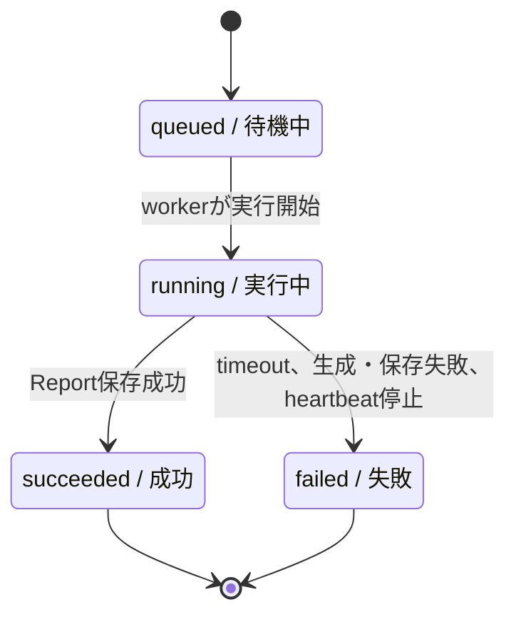
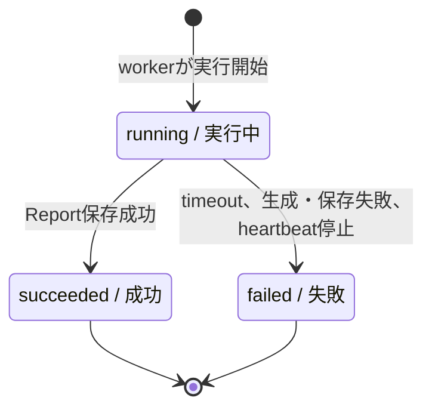

# WatchBrief ドメインモデル

> **Issue #53の既存案について**：以前のAIが作成した未完成の実装案と、それに伴う文書変更を参考として保持している。具体バージョン、ハッシュ、Cookie・CSRF、migration等は、今回利用者と確認したもの以外は採用済みと扱わない。過去の検証結果も今回の実動作確認とは区別する。現在の進め方は[作業計画](work-plan.md#利用者主体で子issueを進める運用合意済み)を参照する。

Userのパスワードは[プロダクト仕様](product-definition.md#ユーザーと認証)に従い、作成・照合・確認入力で共通のNFC正規化と文字数条件を使う。DB用の資格情報とは別物として扱う。

## 目的と範囲

アプリで扱う概念、責務、業務ルール、状態遷移を整理する。利用者向け仕様は[プロダクト仕様](product-definition.md)、テーブルとER図は[DB設計](database-design.md)、処理の担当は[システム設計](system-design.md)を参照する。

概念とアプリのクラス・構造体、DBテーブルを必ず1対1にする必要はない。具体的な型構成や集約境界は実装方式の選定時に検討する。

## 概念と責務

| 概念 | 責務 |
|---|---|
| User | Collectionと生成履歴の所有者。利用者ごとに閲覧・編集可能な範囲を分ける |
| 認証セッション | ログイン成功後のブラウザとUserの対応を表す。PostgreSQLで管理し、API要求時の本人確認とログアウト時の無効化に使う |
| Collection | 調査単位。名前、調査方針、有効状態、表示順、初回の更新確認方針を持つ |
| CollectionSchedule | Collectionの生成予定。日本時間のcron式で表し、1 Collectionにつき最大1つ |
| WatchTarget | Collection内の個別調査対象。名前、補足指示、有効状態、表示順を持つ |
| InformationSource | 対象に登録する優先情報源。名称、URL、補足指示を持ち、0件でもよい |
| GenerationJob | ある予定に対応する1回の生成全体。作成時の名前と入力スナップショットを保持する |
| GenerationAttempt | workerが実際に開始した1回の実行。開始・終了、生存確認、結果と失敗理由を持つ |
| Report | 成功した実行の読み取り専用の結果。現在状態、更新・新着、出典、取得失敗、完成Markdownを持つ |

Report内の対象別結果、事実、情報源、事実と出典の対応、取得失敗を保存するテーブルへの分割はDB設計に記載する。

Issue #53ではUser作成・ログイン・本人情報取得だけを対象とする。[現在の基本設計案](system-design.md#issue-53の基本設計)は既存のUser・認証セッションを使い、画面技術の選定によって新しい業務概念・状態を追加しない。[旧AI案の認証方式](auth-implementation.md)と[物理スキーマ案](database-design.md#issue-53の認証物理スキーマ)は今回の採用決定と区別する。ログアウトAPIは[Issue #54の設計](system-design.md#issue-54のログアウトapi)で具体化する。再設定の具体処理は[管理コマンドの詳細](password-reset.md)を参照する。

認証セッションは生成JobやReportの業務状態とは独立する。ブラウザにはランダムトークンをCookieで渡し、DBには照合用ハッシュとUserの対応を保存する。ログアウト時はCookieに対応する1セッションを物理削除して無効化し、同じUserの他端末・他Userのセッションを維持する。削除済みセッションの正規形式トークンによるログアウト再試行も成功とする。保存障害時は成功と断定せず再試行可能とする。通信と保存の処理順は[ログアウト設計](system-design.md#issue-54のログアウトapi)を参照する。管理コマンドでパスワードを再設定した場合は、そのUserの既存セッションをすべて無効化する。再設定と競合したログインで旧パスワードの照合結果を使うセッションも残さない。認証済みの進行中APIは完了し得るが、次の認証では拒否する。パスワード更新と無効化は一体として確定し、他Userのセッションや設定・生成履歴には影響させない。時間・無操作による失効と、利用者が端末を選ぶログアウト管理は引き続き将来検討とする。

## 現在設定と履歴の境界

- Collection配下の設定は将来の生成に使う。対象と情報源はCollection間で共有しない。
- 編集可能なCollection名の正本はCollectionにある。Jobは作成時の名前を保持し、AttemptとReportはJobの名前を使う。
- Job作成時に生成入力を固定する。workerは入力スナップショットを使い、設定変更は後続Jobだけに反映する。
- スナップショットには調査方針、初回の更新確認方針、有効な対象・情報源とその識別子を含め、認証情報を含めない。
- 履歴内の対象・情報源IDは生成時の識別値であり、現在設定が削除されても履歴として残る。
- 過去Reportの閲覧時にはAIや情報源を再実行せず、保存済み本文を表示する。

## 設定と削除の業務ルール

- 新規Collectionは停止中であり、対象とScheduleがない状態で本体を保存できる。Issue #18の最初の範囲では、この保存と再表示を扱う。
- 同じUserの同じ作成要求は同じCollectionに対応し、再試行で増やさない。要求番号は認証やCollectionの識別子とは分ける。削除後の旧要求からCollectionを復活させない。
- Collection本体の編集で先行更新を検出した場合は古い取得値による保存を拒否し、利用者が最新値を確認して編集し直す。項目単位の自動統合は行わない。作成要求記録は現在設定の編集で変更しない。具体的な版・再試行の保存方式は未決定とする。
- Collectionを有効にするには、有効な対象とScheduleが必要である。
- 最後の有効な対象またはScheduleを無効化・削除する前にCollectionを停止する。
- 停止後は待機中・実行中Jobがあっても配下設定を編集・削除できる。
- 待機中・実行中Jobがある間はCollection自体を削除できない。削除後も完了済みJob、Attempt、Reportを保持する。
- Collection削除と新規Job作成が競合しても、削除済み設定からJobを作らない。
- 初期MVPではUser、Job、Attempt、Reportを削除する機能を持たない。
- 情報源が0件でも対象を保存でき、最後の情報源も削除できる。同じ対象への同一URL登録は許可する。

## 生成と調査結果の業務ルール

- 同じCollection・同じ予定のJobは1件だけとする。同じCollectionの生成は直列化し、別Collectionは独立して実行できる。
- 待機中JobにはAttemptがなく、実行開始時に作成する。初期MVPは自動retryなしで最大1 Attemptとし、将来は追加できる関係を持つ。
- 成功したAttemptにはReportが必ず1件あり、失敗したAttemptには存在しない。Report一式の保存と成功確定は一体として扱う。
- 一部情報源の取得失敗でも、取得できた情報でReportを保存できれば生成全体は成功とする。
- workerの停止は生存確認の途絶から別の監視処理で検出する。失敗確定後に元のworkerが戻っても成功へ戻さない。
- Job作成前のScheduler障害はログ・監視で検知し、存在しないJobを過去予定から画面へ復元しない。
- 現在状態は期間を限定せず毎回確認する。更新・新着情報は、同じCollectionの前回成功Attemptの開始から今回の開始までを確認する。
- 生成失敗では更新確認の基準を進めない。対象・情報源の追加や再有効化でもCollection全体の基準を使う。
- 初回はAI判断または1〜365日の指定を選べる。初期値はAI判断で、AIも1〜365日前の範囲から開始を選ぶ。
- AIはMarkdown断片を含む構造化データを返す。アプリが検証し、完成Markdownを組み立てる。
- 調査できた対象には現在状態を必須とし、各事実には同じ対象の出典を必須とする。
- 登録済み情報源と生成中に発見した情報源を区別し、発見した情報源を設定へ自動登録しない。
- 未検証のAI生レスポンスをReportとして保存しない。出力検証と表示の詳細はプロダクト仕様を参照する。

## 生成状態の遷移

GenerationJobは作成時に `queued` となり、workerが処理を始めると `running` へ進む。`queued` または `running` のJobがある間はCollectionを削除できない。

GenerationAttemptはworkerが実行を始める時点で `running` として作成し、処理結果に応じて `succeeded` または `failed` へ進む。

## 生成失敗の分類

GenerationAttemptの `failure_type` は、処理結果を表す `status` とは分けて、失敗した理由を記録する。

| `failure_type` | 意味 |
|---|---|
| `timeout` | 生成処理全体が制限時間を超えた |
| `ai_error` | AIサービスの呼び出しに失敗した |
| `invalid_output` | AIは応答したが、生成結果が必要な形式を満たさなかった |
| `persistence_error` | Reportまたは関連データのDB保存に失敗した |
| `worker_interrupted` | workerまたは実行環境が処理途中で停止した |
| `unexpected_error` | ほかの分類に該当しない想定外のエラーが発生した |

- `running` または `succeeded` のAttemptでは `failure_type` を持たない。
- `failed` のAttemptでは `failure_type` を必須とする。
- 一部の情報源を取得できなくてもReportを保存できた場合は、Attemptを `succeeded` とし、個別の失敗を Report内の取得失敗記録 に記録する。

## 設計の確定範囲

以上は合意した概念と業務ルールである。テーブル、カラム、外部キー、制約、日時の保存先、トランザクション境界、保持・バックアップ、インデックスと物理スキーマの確定時期は[DB設計](database-design.md)に記載する。

## Issue #56の読み取り実装

既存Collection配下の概念を読み取り専用で保存・取得する。所有者は認証セッションから特定し、Collection名等の現在設定の正本はCollectionに置く。設定取得で業務状態を変えない。管理seedは停止中の架空Collectionを既存Userへ追加し、実データや既存設定を更新しない。編集・ON条件の操作経路は #18、生成履歴は #57以降で扱う。

## 保存履歴を読む最初の実装（Issue #57）

管理seedがJob・Attemptの成功とReport一式を原子的に保存し、アプリは保存済み本文を読む。所有者は必須のJob.user_idで確定し、Collectionの現在の有無に依存しない。本文は構造化データと同じDBを正本とする。生成・状態遷移を実行するWorkerは #19の対象であり、seedは生成処理の代用仕様ではない。[物理制約](database-design.md#保存reportの物理化issue-57)と[最小閲覧](画面仕様/保存済みReportの取得.md)を参照する。
