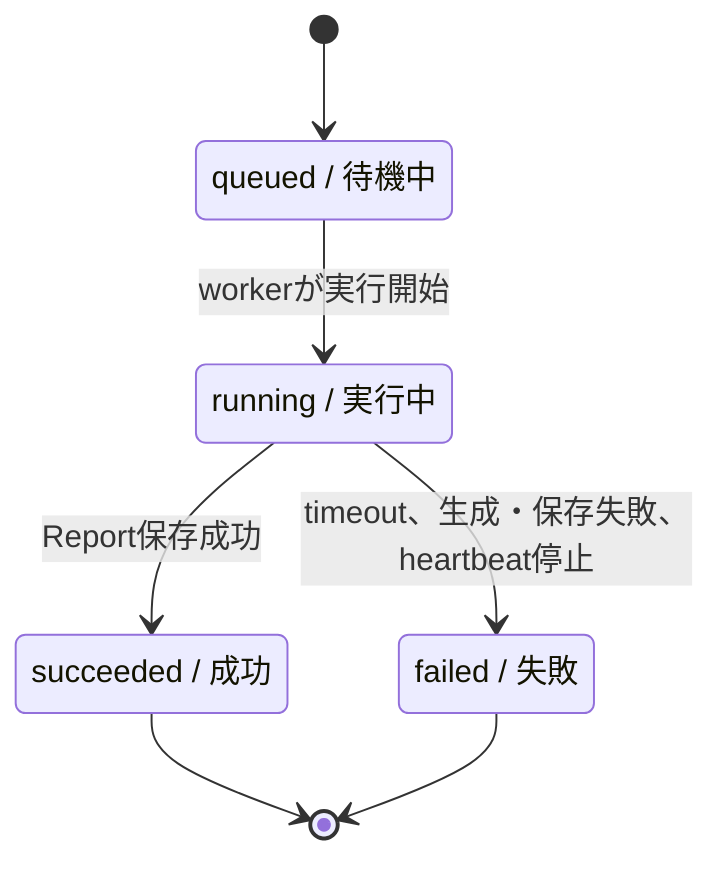
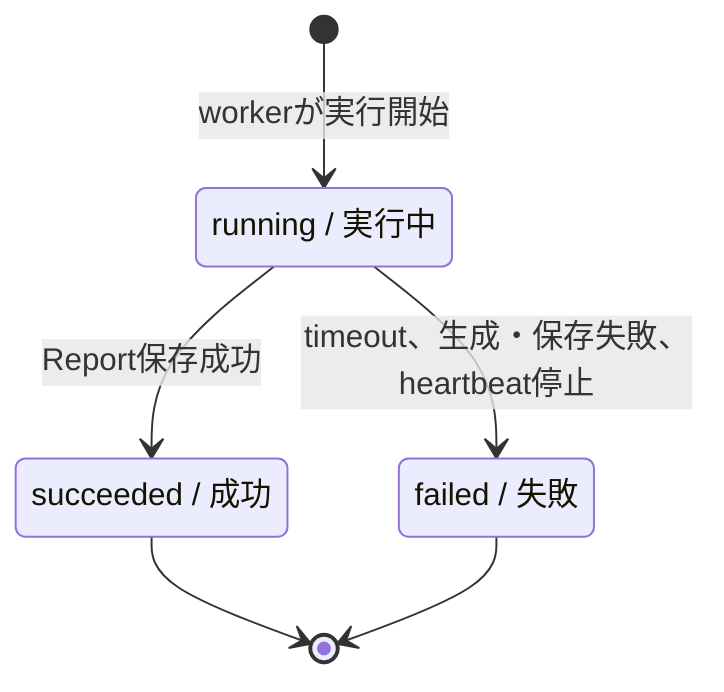

# WatchBrief ドメインモデル

## 目的と範囲

アプリで扱う概念、責務、業務ルール、状態遷移を整理する。利用者向け仕様は[プロダクト仕様](product-definition.md)、テーブルとER図は[DB設計](database-design.md)、処理の担当は[システム設計](system-design.md)を参照する。

概念とアプリのクラス・構造体、DBテーブルを必ず1対1にする必要はない。具体的な型構成や集約境界は実装方式の選定時に検討する。

## 概念と責務

| 概念 | 責務 |
|---|---|
| User | Collectionと生成履歴の所有者。利用者ごとに閲覧・編集可能な範囲を分ける |
| 認証セッション | ログイン成功後のブラウザとUserの対応を表す。PostgreSQLで管理し、API要求時の本人確認とログアウト時の無効化に使う |
| Collection | 調査単位。名前、調査方針、有効状態、表示順、初回の更新確認方針を持つ |
| CollectionSchedule | Collectionの生成予定。日本時間のcron式で表し、1 Collectionにつき最大1つ |
| WatchTarget | Collection内の個別調査対象。名前、補足指示、有効状態、表示順を持つ |
| InformationSource | 対象に登録する優先情報源。名称、URL、補足指示を持ち、0件でもよい |
| GenerationJob | ある予定に対応する1回の生成全体。作成時の名前と入力スナップショットを保持する |
| GenerationAttempt | workerが実際に開始した1回の実行。開始・終了、生存確認、結果と失敗理由を持つ |
| Report | 成功した実行の読み取り専用の結果。現在状態、更新・新着、出典、取得失敗、完成Markdownを持つ |

Report内の対象別結果、事実、情報源、事実と出典の対応、取得失敗を保存するテーブルへの分割はDB設計に記載する。

認証セッションは生成JobやReportの業務状態とは独立する。ブラウザにはランダムトークンをCookieで渡し、DBには照合用ハッシュとUserの対応を保存する。ログアウト時は対象セッションを無効化する。管理コマンドでパスワードを再設定した場合は、そのUserの既存セッションをすべて無効化する。パスワード更新と無効化は一体として確定し、他Userのセッションや設定・生成履歴には影響させない。時間・無操作による失効と、利用者が端末を選ぶログアウト管理は引き続き将来検討とする。

## 現在設定と履歴の境界

- Collection配下の設定は将来の生成に使う。対象と情報源はCollection間で共有しない。
- 編集可能なCollection名の正本はCollectionにある。Jobは作成時の名前を保持し、AttemptとReportはJobの名前を使う。
- Job作成時に生成入力を固定する。workerは入力スナップショットを使い、設定変更は後続Jobだけに反映する。
- スナップショットには調査方針、初回の更新確認方針、有効な対象・情報源とその識別子を含め、認証情報を含めない。
- 履歴内の対象・情報源IDは生成時の識別値であり、現在設定が削除されても履歴として残る。
- 過去Reportの閲覧時にはAIや情報源を再実行せず、保存済み本文を表示する。

## 設定と削除の業務ルール

- Collectionを有効にするには、有効な対象とScheduleが必要である。
- 最後の有効な対象またはScheduleを無効化・削除する前にCollectionを停止する。
- 停止後は待機中・実行中Jobがあっても配下設定を編集・削除できる。
- 待機中・実行中Jobがある間はCollection自体を削除できない。削除後も完了済みJob、Attempt、Reportを保持する。
- Collection削除と新規Job作成が競合しても、削除済み設定からJobを作らない。
- 初期MVPではUser、Job、Attempt、Reportを削除する機能を持たない。
- 情報源が0件でも対象を保存でき、最後の情報源も削除できる。同じ対象への同一URL登録は許可する。

## 生成と調査結果の業務ルール

- 同じCollection・同じ予定のJobは1件だけとする。同じCollectionの生成は直列化し、別Collectionは独立して実行できる。
- 待機中JobにはAttemptがなく、実行開始時に作成する。初期MVPは自動retryなしで最大1 Attemptとし、将来は追加できる関係を持つ。
- 成功したAttemptにはReportが必ず1件あり、失敗したAttemptには存在しない。Report一式の保存と成功確定は一体として扱う。
- 一部情報源の取得失敗でも、取得できた情報でReportを保存できれば生成全体は成功とする。
- workerの停止は生存確認の途絶から別の監視処理で検出する。失敗確定後に元のworkerが戻っても成功へ戻さない。
- Job作成前のScheduler障害はログ・監視で検知し、存在しないJobを過去予定から画面へ復元しない。
- 現在状態は期間を限定せず毎回確認する。更新・新着情報は、同じCollectionの前回成功Attemptの開始から今回の開始までを確認する。
- 生成失敗では更新確認の基準を進めない。対象・情報源の追加や再有効化でもCollection全体の基準を使う。
- 初回はAI判断または1〜365日の指定を選べる。初期値はAI判断で、AIも1〜365日前の範囲から開始を選ぶ。
- AIはMarkdown断片を含む構造化データを返す。アプリが検証し、完成Markdownを組み立てる。
- 調査できた対象には現在状態を必須とし、各事実には同じ対象の出典を必須とする。
- 登録済み情報源と生成中に発見した情報源を区別し、発見した情報源を設定へ自動登録しない。
- 未検証のAI生レスポンスをReportとして保存しない。出力検証と表示の詳細はプロダクト仕様を参照する。

## 生成状態の遷移

GenerationJobは作成時に `queued` となり、workerが処理を始めると `running` へ進む。`queued` または `running` のJobがある間はCollectionを削除できない。

GenerationAttemptはworkerが実行を始める時点で `running` として作成し、処理結果に応じて `succeeded` または `failed` へ進む。

## 生成失敗の分類

GenerationAttemptの `failure_type` は、処理結果を表す `status` とは分けて、失敗した理由を記録する。

| `failure_type` | 意味 |
|---|---|
| `timeout` | 生成処理全体が制限時間を超えた |
| `ai_error` | AIサービスの呼び出しに失敗した |
| `invalid_output` | AIは応答したが、生成結果が必要な形式を満たさなかった |
| `persistence_error` | Reportまたは関連データのDB保存に失敗した |
| `worker_interrupted` | workerまたは実行環境が処理途中で停止した |
| `unexpected_error` | ほかの分類に該当しない想定外のエラーが発生した |

- `running` または `succeeded` のAttemptでは `failure_type` を持たない。
- `failed` のAttemptでは `failure_type` を必須とする。
- 一部の情報源を取得できなくてもReportを保存できた場合は、Attemptを `succeeded` とし、個別の失敗を Report内の取得失敗記録 に記録する。

## 設計の確定範囲

以上は合意した概念と業務ルールである。テーブル、カラム、外部キー、制約、日時の保存先、トランザクション境界、保持・バックアップ、インデックスと物理スキーマの確定時期は[DB設計](database-design.md)に記載する。
