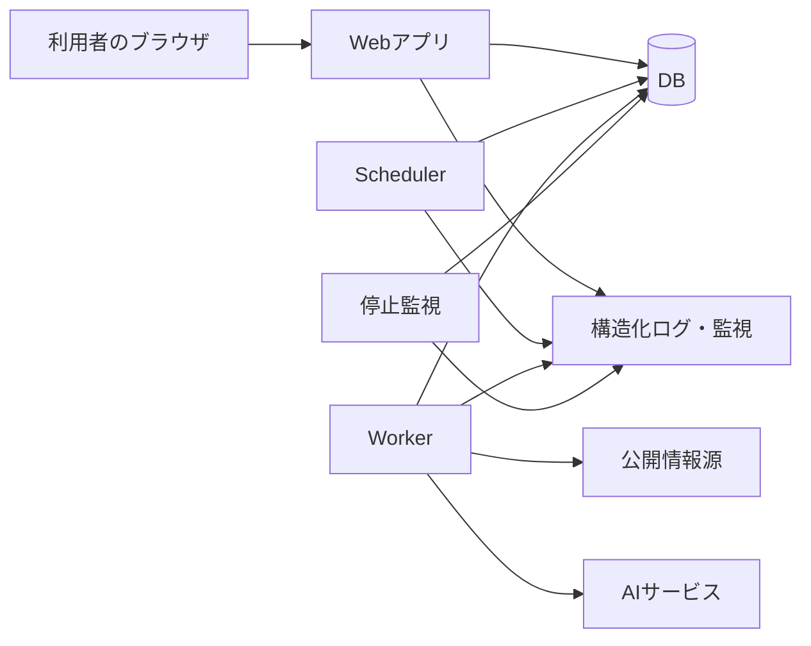
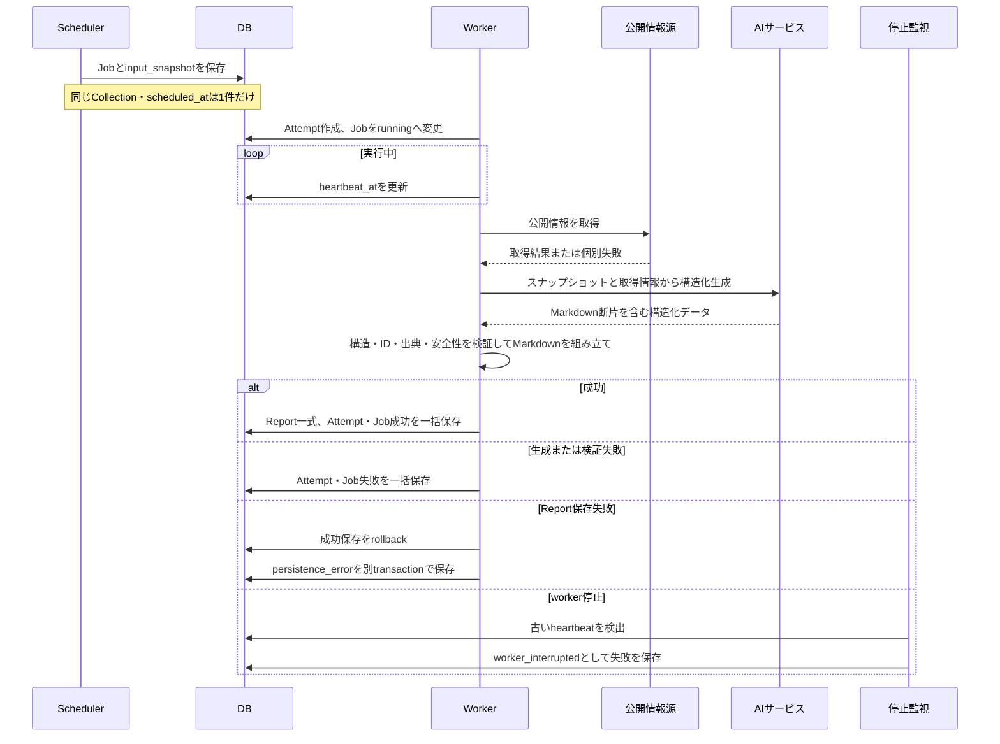

# WatchBrief システム設計

> [!NOTE]
> この文書は論理アーキテクチャを示す。各コンポーネントを別サービスとして配備するか、同じアプリケーション内のプロセスとして動かすかは未決定である。framework、DB製品、queue、クラウドサービスもこの文書では固定しない。

## 目的

利用者向けWeb画面、定期実行、AIによる調査、レポート保存、異常検知の責務を分け、正常時と失敗時のデータの流れを実装前に共有する。

詳細な利用者向け仕様は[プロダクト仕様](product-definition.md)、データ構造と状態遷移は[ドメインモデル](domain-model.md)を正とする。

技術を選ぶ目的、現在の候補、採用前に比較する事項は[技術選定の前提](technical-direction.md)を参照する。

## 論理構成

この図は責務の分かれ方を表す。配備単位やネットワーク境界は表していない。

### Webアプリ

- ログイン、ログアウト、認可を扱う。
- Collection、WatchTarget、InformationSource、Scheduleを表示・編集する。
- GenerationJobの状態と、保存済みReportを表示する。
- 他ユーザーのリソースは存在を明かさず404として扱う。
- AI生成を画面リクエスト内で待たず、保存済み状態を読み取る。

### Scheduler

- CollectionScheduleのcron式を日本時間として解釈する。
- 予定ごとにGenerationJobと、生成入力の `input_snapshot` を同じトランザクションで保存する。
- `(collection_id, scheduled_at)` の一意制約を使い、同じ予定のJobを重複作成しない。
- Collection削除と競合しないよう、同じCollectionを基準に排他制御する。

### Worker

- 待機中のJobを取得し、Attempt作成とJobの実行中への変更を同じトランザクションで行う。
- 現在のCollection設定ではなく、Job作成時の `input_snapshot` を使う。
- 公開情報を調査し、AIからMarkdown断片を含む構造化データを受け取る。
- 対象ID、情報源ID、現在状態、更新・新着情報、出典、Markdown構文を検証する。
- 検証済みデータから完成Markdownを組み立てる。
- Report一式とJob・Attemptの成功状態を同じトランザクションで保存する。

### 停止監視

- 実行中Attemptの `heartbeat_at` を確認する。
- 一定時間更新されていないAttemptとJobを、同じトランザクションで失敗へ変更する。
- `failure_type` に `worker_interrupted` を記録する。
- heartbeatの更新間隔、停止判定時間、監視方式はIssue #7で決める。

### DB

- ユーザーと現在のCollection設定を保存する。
- Job作成時の入力スナップショットを保存する。
- JobとAttemptの実行状態を保存する。
- 検証済みのReport構造化データと完成Markdownを正本として保存する。
- 初期MVPではReport本文をS3などへ分離しない。

## レポート生成フロー

この図は、予定の検出から成功または失敗の確定までの処理順を表す。

同じCollectionのJobは同時実行しない。別CollectionのJobは独立して実行できる。停止判定後に元のworkerが戻っても、Attemptがまだ `running` である場合だけ成功処理を許可し、確定済みの失敗を上書きしない。

## データの正本

| データ | 正本 | 補足 |
|---|---|---|
| 現在の調査設定 | Collection配下のテーブル | 将来作るJobだけに反映する |
| 生成に使う入力 | `GenerationJob.input_snapshot` | Job作成後は変更しない |
| 生成状態 | GenerationJob・GenerationAttempt | 画面は主にJob状態を表示する |
| レポート | Report配下の構造化データと完成Markdown | 閲覧時にAIや情報源を再実行しない |
| 内部エラー | 構造化ログ | DBへ失敗状態を書けない場合も追跡する |

AIサービスの未検証の生レスポンスはReportの正本として保存しない。登録済み情報源は `registered`、生成中にAIが見つけた情報源は `discovered` としてReport内に履歴を残す。`discovered` を現在のCollection設定へ自動登録しない。

## セキュリティと安全性

- パスワードはハッシュ化して保存する。
- 認証情報、token、secretをJobの入力スナップショットやログへ含めない。
- AIが返すMarkdown断片では安全な部分集合だけを許可し、生HTMLを無効にする。
- Markdown表示には保守されている変換ライブラリとHTMLサニタイザーを使う。
- 出典URLは検証し、初期MVPでは `http` と `https` だけを許可する。
- Report本文と構造化データは一括保存し、部分的な成功状態を残さない。
- Collection削除とJob作成の競合はDBトランザクションで排他制御する。

## 失敗時の扱い

- 利用者向け表示、DB上の実行結果、開発者向けログを分ける。
- 一部情報源の取得失敗はReport内に記録し、取得できた情報でReportを保存できれば生成全体は成功とする。
- timeout、AI呼び出し失敗、不正出力、保存失敗、worker停止、想定外エラーを分類する。
- 失敗状態のDB保存にも失敗した場合は、DB外のプロセスログへ元の原因と記録失敗を残す。
- 初期MVPでは自動retryを行わない。将来追加できるようJobとAttemptを分けている。

## 未決定事項

- framework、runtime、package manager
- DB製品、物理型、ORM、migration方式
- Job queueとworkerの実装方式
- Collection削除とJob作成に使う具体的なロック
- timeout値、heartbeat間隔、停止判定時間
- AIサービス、構造化出力方式、利用モデル
- Markdown変換・HTMLサニタイズライブラリと文字数上限
- ログ基盤、監視、通知、保持期間
- デプロイ方式、ネットワーク、権限、バックアップ

これらは論理設計を変更し得る場合、候補と影響を説明して合意した後に文書を更新する。
