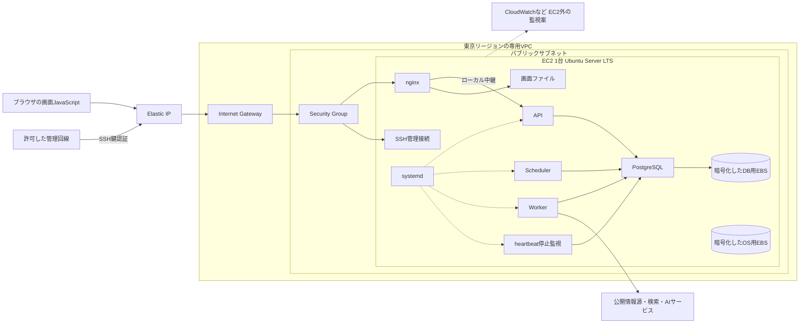
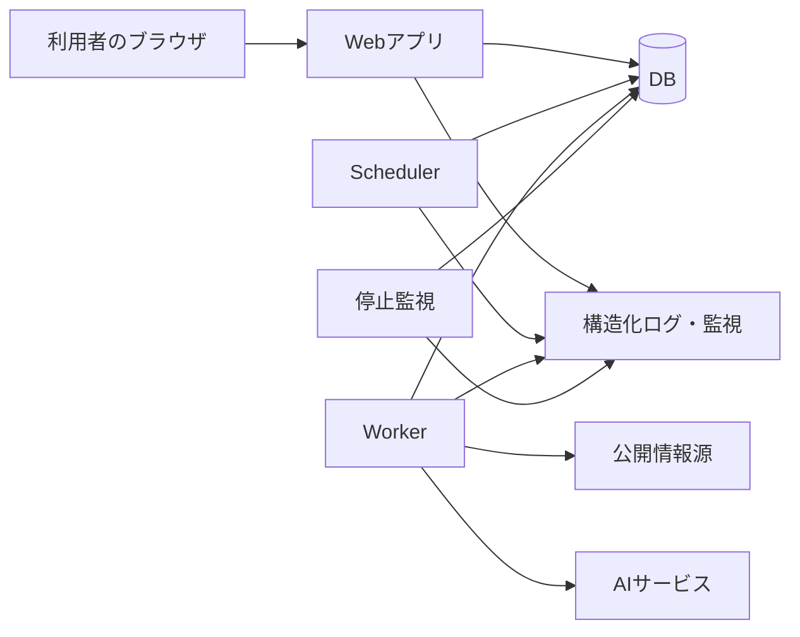
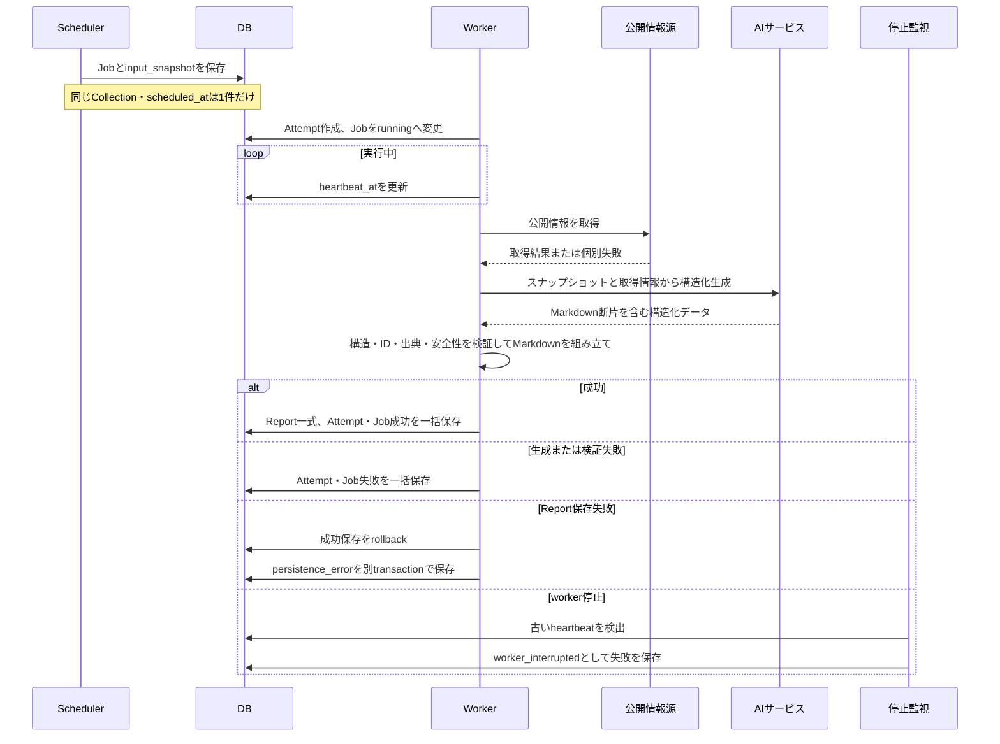

# WatchBrief システム設計

> [!NOTE]
> この文書は論理アーキテクチャと初期配備方針を示す。初期MVPはnginxによる画面配信とPostgreSQLをEC2 1台へ同居させ、API、Scheduler、Worker、停止監視を別プロセスとして動かし、systemdで起動管理する。nginxはAPIへのリバースプロキシも担当する。将来はRDSやECSなどへ段階的に移す。最小骨格はVue・Goを使う方針であり、具体バージョン、周辺framework、ORM、queueは未決定である。

## 目的

利用者向けWeb画面、定期実行、AIによる調査、レポート保存、異常検知の責務を分け、正常時と失敗時のデータの流れを実装前に共有する。

詳細な利用者向け仕様は[プロダクト仕様](product-definition.md)、概念・業務ルール・状態遷移は[ドメインモデル](domain-model.md)、保存構造・ER図・DB制約は[DB設計](database-design.md)を参照する。

技術を選ぶ目的、現在の候補、採用前に比較する事項は[技術選定の前提](technical-direction.md)を参照する。

## 読む順序

1. [論理構成](#論理構成)：ブラウザ、API、Scheduler、Worker、監視、DBの役割。
2. [レポート生成フロー](#レポート生成フロー)：Job作成からReport保存・閲覧まで。
3. [初期配置の全体像](#issue-11の範囲と初期構成の全体像)と[ネットワーク](#初期ネットワークの方針)：EC2への配置と通信境界。
4. [認証・公開境界・秘密情報](#issue-1の認証公開境界秘密情報設計)：ログイン・ログアウト、非公開データ、権限、Secret、SSRF。
5. [構築・運用の設計案](#構築運用の設計案)と[実装への引き継ぎ](#実装構築への引き継ぎと依存関係)：合意済み方針を具体化する作業。

## Issue #11の範囲と初期構成の全体像

Issue #11の成果物はインフラ・運用設計である。アプリ実装、ローカル実行環境の構築、AWSリソース作成、外部公開はこの設計作業には含めない。合意済みの事項を以下にまとめ、まだ相談していない具体方式は「設計案」として記載する。設計案の記録は採用決定ではない。

以下は合意済みの配置・責務をまとめたものであり、構築済み・動作確認済みを意味しない。

| 範囲 | 初期の形 |
|---|---|
| AWSの配置 | 東京リージョンの専用VPC、パブリックサブネット、EC2 1台、Internet Gateway、Elastic IP 1つ |
| OSと管理 | Ubuntu Server LTS、管理回線のIPに限定したSSH鍵認証、systemdでプロセス管理 |
| 画面とAPI | nginxが画面ファイルを配信し、ブラウザのJavaScriptからのAPI要求を同じEC2内のAPIへ中継 |
| 自動生成 | SchedulerがJobを保存し、Workerが生成・保存、別プロセスがheartbeatを監視 |
| DBと保存 | 同居するPostgreSQL。OS用・DB用EBSを分離し、両方をAWS管理鍵で暗号化。DB用EBSはEC2削除時も保持 |
| 更新と将来 | 初期は手動デプロイ。将来RDS分離、Session Manager、コンテナ・ECSなどへ段階的に移行 |

正常時の一連の流れは、ブラウザへの画面配信、APIでの認証・設定取得、SchedulerのJob登録、Workerの調査・生成とDB保存、画面からのReport閲覧である。処理順と保存の境界は後段の論理構成・レポート生成フローを正とする。起動から運用までの手順案は本書の「構築・運用の設計案」でまとめる。

VueとGoを使う最小骨格の方針には合意したが、アプリの実装と動作確認は別作業で扱う。ドメイン名やAMIなどの実値をこの設計で固定する必要はない。未実装を動作確認済みとは扱わず、認証・HTTPSが未実装のアプリや実データを外部公開しない。

## 初期インフラの合意範囲

- Issue #11で、初期MVPは画面配信、API、Scheduler、Worker、停止監視、DBをEC2 1台へ同居させる方針に合意した。初期からRDSを使う決定を更新し、構築・運用を経験しながら段階的にAWSのマネージドサービスを利用する。
- 初期OSは標準版のUbuntu Server LTSを採用する。Amazon Linux 2023と比較し、AWS以外のLinuxサーバーや将来のRaspberry Pi運用にも経験を活かしたい意向を重視した。media-vault側のOSを決定するものではない。
- Ubuntuの具体的なLTSバージョン、公式AMIのID・提供元確認、CPUアーキテクチャ、nginx・PostgreSQL・アプリruntimeとの互換性、OS更新・再起動の手順は今後確認・設計する。Ubuntu Proなどの有料版を採用する決定ではない。
- 初期EC2は新規作成するWatchBrief専用VPC内のパブリックサブネットに配置し、Internet Gateway経由でインターネットへ接続する。デフォルトVPCは利用しない。公開IPと経路を設定してWeb公開、管理回線からのSSH、外部情報取得・API呼び出しを行う。アドレス設計とVPCの作成手順・IaC方式などの具体設定は未決定である。
- 保守・障害時の利用停止を許容し、運用者が調査・復旧する。初期MVPでは冗長化によるサービス継続を前提にしない。EC2やディスクの障害はアプリとDBの両方へ影響する。
- API、Scheduler、Worker、停止監視は同居するPostgreSQLを使用する。SQLiteとの比較から、複数プロセスでの利用、自前DBの運用学習、将来同じエンジンでRDSへ移せることを重視して採用した。DBデータはOS用とは別のDB用EBSへ保存する。バージョン、ディスクの容量・種類と具体設定、接続・認証方式、設置・更新手順は未決定である。AIサービスや公開情報源までEC2内で自前運用する意味ではない。
- 将来RDSへ移す際はインターネットへ公開せず、通常のDB接続元をアプリ実行環境に限定する。EC2から接続する段階ではSecurity Groupでアプリ用EC2からのDB接続を許可する方針とする。ECSなどへの移行後の具体設定、ポート、管理用接続経路、DB認証方式は今後設計する。
- 画面側（Frontend）とAPI側（Backend）を分ける。EC2上ではAPI、Scheduler、Worker、heartbeatによる停止監視を別プロセスとし、個別に起動・停止できる構成を採用する。従来の「Web」プロセスは、この構成ではAPIを担当する。
- 各プロセスの初期の起動管理にはsystemdを採用する。Web公開の入口は同じEC2のnginxとし、画面ファイルの配信とAPIへの中継を担当させる。アプリ更新は初期は手動デプロイとする。ネットワーク、デプロイの具体手順、systemdとnginxの具体設定は未決定である。
- APIプログラムとPostgreSQLはEC2内部からの接続に限定する。Web用の外部接続はnginxへ集約し、API・DBの直接接続用ポートはSecurity Groupで外部から許可しない。API・DBの待受もローカルに限定する。具体的なアドレス・ポート・ソケット方式、DB認証、管理用接続の具体設定は未決定である。
- EC2への管理接続は初期はSSHとし、将来Session Managerへ早めに移行する。移行優先度はDBのRDS分離の次くらいを目安とする。これはWeb用の入口とは別の管理接続であり、初期SSHは接続元を管理回線のグローバルIPに限定し、鍵認証を使う。パスワードによるSSHログインは無効にする。
- EC2全体が停止すると、同じEC2内の監視処理も動作できない。EC2全体の停止を検知する方式は、後述の設計案でEC2外の監視として扱う。採用方式は未合意である。
- DBバックアップとGitへのMarkdownアーカイブは初期MVPの対象外であり、停止から復帰できても失ったDBデータを復元できるとは限らない。失って困る実データを継続運用する前にバックアップ方針を再確認する。
- 将来はDBをRDSへ移し、アプリをコンテナ化してECSなどで動かすことを目指す。RDSのDBエンジン（Auroraを含む比較）、ECSの採用確定、Fargateなどの実行方式、移行時期・条件、復旧時間の目標と手順は未決定である。

## 初期ネットワークの方針

初期EC2と専用VPCは東京リージョン（`ap-northeast-1`）に配置する。日本からの利用を想定し、近い地域にまとめることを重視した。AZ・EC2のサイズは未決定であり、実際の通信遅延や具体構成の料金比較は未検証である。Bedrockなど外部AIサービスの利用地域は、この決定では固定しない。

| 要素 | 合意した役割 | 未決定の具体設定 |
|---|---|---|
| VPC | 東京リージョンにWatchBrief専用として新規作成し、初期EC2を置く。デフォルトVPCは利用しない | IP範囲、作成手順・IaC方式 |
| パブリックサブネット | EC2を置き、Internet Gatewayへの経路を持つ | AZ、IP範囲、具体的なルート設定 |
| Internet Gateway | VPCとインターネット間の経路 | 関連付け、ルートテーブル |
| EC2の公開IP | Elastic IPを1つ使用し、外部からnginxや許可されたSSHへ到達するための固定IPv4とする | IPv6の採用範囲、実際のIP、DNSとの関連付け |
| Security Groupと待受設定 | nginxへのWeb接続、管理回線からのSSHを制御し、API・DBの外部直接接続を許可しない | Web・管理用の具体的なポートとルール、外向き通信の制御 |

パブリックサブネットへの配置は全プロセスの公開を意味しない。APIとPostgreSQLはEC2内部からの接続に限定する。EC2から外部情報源やAIサービスへ出る通信経路は必要だが、外向きの許可範囲は今後設計する。

デフォルトVPCを使う案と比較し、WatchBrief用のリソースと設定の影響範囲を整理し、subnetや経路の構築を学ぶため専用VPCの新規作成を選んだ。VPC自体の作成・利用に追加料金はないが、EC2・公開IP・追加するネットワーク機能などは別途費用を確認する。この方針は既存VPCを変更・削除する指示ではない。

非公開サブネットへEC2を置いて別のWeb入口・外向き通信経路を用意する案と比較し、初期は構成要素を少なくして通信経路と接続制限を学ぶことを優先した。Internet Gateway自体に利用料金はないが、公開IPv4やデータ転送などは費用の確認対象とする。具体構成が決まった段階で東京リージョンの公式料金を確認して見積もる。

将来のRDS分離時はDBを非公開の区画へ配置する方向で設計する。必要なsubnet・AZ・接続制限は、その時点のDB構成に合わせて決め、初期から将来用のリソースを作成する決定にはしない。

### Elastic IPと独自ドメイン

- 公開IPv4はElastic IPを1つ使用する。自動割り当ての公開IPv4ではEC2の停止・起動時にIPが変わるため、ドメインの接続先を安定させることを重視した。Elastic IPは解放せず保持し、関連付けを維持する間は固定IPとして扱う。
- Elastic IPはEC2を停止しても保持中は課金対象となる。通常の自動割り当て公開IPv4も課金対象であり、固定IPだけが有料という比較はしない。取得時と運用時に公式料金・使用数を確認し、不要時の解放はDNS・接続への影響を確認して判断する。
- 独自ドメインを取得して利用する方針は維持する。ドメイン名と取得方法の決定は後回しにし、現在のインフラ設計を進める前提条件にはしない。
- アプリごとにドメインを取得する案と、共用の親ドメインのサブドメインを使う案は未決定とする。以前の共用方針は更新した。`smofktn` は会話で挙がった名前の候補であり、末尾や完全なドメイン名、取得可否は確定していない。
- ほかのアプリのドメイン・公開・配備先はそのプロジェクトで判断する。WatchBriefの認証・Cookie設定はIssue #1と合わせ、実際に使用するホスト名が決まった段階で具体化する。
- 登録事業者、DNSサービス、予算、登録期間・更新、登録者情報の公開範囲は未決定である。
- 実際のドメイン名とElastic IPが決まった後、DNSでの対応付けとHTTPS証明書の取得・更新方法を設計する。今回の合意はIP確保やドメイン購入を実施する承認ではない。

### 配置とネットワーク境界の構成図

実装前の配置図である。実線は合意済みの配置・通信の方向を示し、破線は後述する未合意の監視・権限設計案を示す。公開ポートの実値、DNS事業者、AIサービスは確定していない。

APIとDBへはSecurity Groupから直接到達する経路を設けない。nginxとSSHも同じEC2上に配置する。図のsystemdからの破線は個別の起動・停止設定が設計案であることを示し、systemd採用自体は合意済みである。

## 初期ストレージの方針

PostgreSQLのデータはOS用とは別のEBSボリュームへ保存する。同じディスクへまとめる案より接続・マウント設定の管理は増えるが、OS・アプリの再配置とDBデータの扱いを分けて学び、EC2を作り直す際にもDBディスクを保持して扱いやすくすることを重視した。

| ボリューム | 用途 | 未決定の具体設定 |
|---|---|---|
| OS用EBS | Linux、アプリ、通常のログ。AWS管理鍵で暗号化する | 容量、種類、配置、ログの保持・容量制御、EC2削除時の削除方針 |
| DB用EBS | PostgreSQLのデータ。AWS管理鍵で暗号化し、EC2削除時も保持する（`DeleteOnTermination=false`） | 容量、種類、ファイルシステム、保存場所、所有者・権限、マウント、保持後の管理・削除手順 |

OS用・DB用EBSの両方に暗号化を明示し、東京リージョンのAWS管理KMS鍵 `aws/ebs` を使用する。初期にはカスタマー管理鍵を作成しない。独自の鍵管理を増やさずに始めることを重視した。構築時は使用するAMI・ボリュームの暗号化状態と鍵を確認し、アカウントやAMIの既定値だけで意図した状態になるとは扱わない。アカウント全体の暗号化既定設定を変更する決定ではない。

EBS暗号化は保存データとEC2・EBS間のデータを保護し、アプリやSQLに独自の暗号化処理を追加する方式ではない。API・DBの認証、認可、権限管理とバックアップの代わりにはならない。AWS管理鍵の作成・保管料は不要だが、KMS利用リクエストなどの料金は見積もり時に公式情報で確認する。

DB用EBSはEC2削除時も保持する。`DeleteOnTermination=false` を明示的に設定し、構築後に設定値を確認する。実装の既定値から保持を保証しない。保持したEBSはEC2を停止・削除した後も課金対象となり、不要時はデータ・接続への影響を確認して削除を別途判断する。OS用EBSの削除方針は、再構築とログ保存の設計に合わせて今後決める。別のEC2へ接続して利用する場合は、同じAZへの配置、PostgreSQLの互換性、権限なども確認する。

容量と性能に応じた料金は具体構成の決定時に見積もる。起動時にDB用EBSが利用できない場合のPostgreSQL起動制御、容量監視、データ保持・再接続の手順案は後述する。具体コマンドと設定値は構築時に検証する。

DB用EBSは正本データの保存先であり、バックアップではない。破損・誤削除への復元手段は追加せず、DBバックアップとGitへのMarkdownアーカイブを初期MVP対象外とする合意を維持する。

## 初期デプロイの方針

初期は運用者が更新を開始する手動デプロイを採用する。GitHub Actionsなどで最初から配置・再起動まで自動化する案と比較し、配置、プロセス再起動、動作確認、失敗時の対応を順番に理解することを優先した。手順を整理して後から自動化できるようにし、繰り返す操作のスクリプト化は検討する。具体的な自動化ツールと導入時期は未決定である。

次は設計する手順の流れであり、実行コマンドや配備方式の確定ではない。

1. 対象の版をビルド・確認する。
2. 新しい版をEC2へ配置する。
3. 対象のプロセスを再起動する。
4. 画面・API・ログを確認する。
5. 問題があれば切り戻しを判断する。

ビルド場所、成果物の形式・保管先・転送方法、版の識別と保持、配置先の切り替え、更新順、実行中Jobの扱い、具体的な確認項目・切り戻し条件は未決定である。DBスキーマやデータも変更する更新は、アプリを前の版に戻すだけでは切り戻せない場合があるため、migrationと互換性を別途設計する。バックアップを初期MVPへ追加する決定ではない。

## 構築・運用の設計案

この節はIssue #11の設計成果物として、これまで合意した構成を運用へつなぐ案をまとめる。個別に合意していないサービス・設定・配置は提案であり、構築済み・採用確定とは扱わない。細かな数値は一つずつ今決めず、下記の引き継ぎ表に集約する。

### Web・管理・外向き通信

| 境界 | 設計案 | 確認すること |
|---|---|---|
| Web入口 | nginxでHTTPSを終端し、HTTPはHTTPSへの転送と証明書検証に必要な用途へ限定する | TLS設定、HTTPを使う検証方式の要否、nginx設定検査後のreload |
| 管理入口 | SSHはTCP 22を管理回線の単一IPへ限定する。rootへの直接ログインは無効とし、一般管理ユーザーから必要時だけ権限を上げる | 接続元IP、ホスト鍵、鍵紛失・IP変更時の復旧経路。鍵認証・パスワードSSH無効は合意済み |
| API・DB | ローカルTCPまたはUnix socketで接続し、外部のSG受信許可を作らない | IPv4・IPv6両方の待受、DB認証、内部ポートの一致 |
| 外向き | 情報取得・外部AI・パッケージ更新・証明書更新に必要なHTTP/HTTPS、DNS、時刻同期、監視送信を整理する | 公開情報源のIPは変動するため固定IPリストだけに依存しない。IPv6を使う場合も経路・SGを別途確認 |

HTTPS証明書はLet's EncryptとACMEクライアントを第一案とする。取得・自動更新・期限監視・更新後のnginx reloadまでを一組として設計する。DNS名と認証方式が決まる前に証明書発行を実施しない。HTTP-01とDNS-01のどちらを使うかは、DNSの運用方式と必要な権限で判断する。ALBなどの追加入口は初期の合意構成に含めず、必要になれば費用と合わせて再検討する。

公開情報の取得処理では、localhost・プライベートアドレス・リンクローカル・インスタンスメタデータなどへのアクセスを拒否し、リダイレクト先・名前解決後の実接続先にも制限を適用する大枠にIssue #1で合意した。後段の「外部URL取得のSSRF対策」を参照する。具体的な接続制御やIMDSv2必須化等のインフラ設定は詳細設計へ残し、IMDSv2だけでSSRF対策が完了するとは扱わない。

### IAM・OS権限・秘密情報

以下はIssue #11時点の具体案である。その後Issue #1で合意した「通常実行と管理操作の権限分離」の範囲は、後段の同名節を参照する。非root実行・DBの通常用と管理用の分離・必要時の最小権限IAMロールは合意済みとなったが、SSHユーザーの昇格方法、Secret注入方式、監視サービス等の残りの具体案は未合意のままである。

| 主体 | 設計案 | 初期に与えない権限・注意点 |
|---|---|---|
| 運用者 | AWSの操作権限とEC2内の管理権限を分け、SSH一般ユーザーから必要な管理操作を実行 | アプリの実行にAWS管理者権限を渡さない |
| EC2のIAMロール | 使うAWS APIがある場合だけinstance profileを付け、対象と操作を限定する。長期アクセスキーをサーバーへ配置しない | S3・Bedrock・Session Managerは未採用のため先回りして権限を付けない |
| API・Scheduler・Worker・停止監視 | 非rootユーザーで実行し、設定・コード・書き込み先の権限を分ける。DBユーザーも管理者とアプリを分ける | DDL・ユーザー管理は通常のAPIやWorkerへ許可しない。migration用権限は更新時に限定 |
| 監視送信処理 | CloudWatchを採る場合、送信するロググループ・メトリクスnamespaceへ権限を限定 | 不要なログ閲覧・IAM変更・他環境への書き込みは許可しない |

EC2に付くIAMロールはホストで共有されるため、プロセスを分けるだけでAWS権限を完全分離できるとは考えない。WorkerだけにBedrock権限を付けたいなど強い分離が必要になれば、別の実行環境やECSのタスクロールなどを移行時に検討する。初期は使うAWSサービスを絞り、秘密情報をメタデータ経由で取得できる範囲も確認する。

初期の秘密情報注入は、Git・成果物・DBの入力スナップショットと分離した、EC2内のroot所有ファイルをsystemdから渡す方式を第一案とする。ファイルは必要なプロセス以外に読ませず、環境変数・systemd credentialsなどの具体方式は[Secretの保管・注入](#secret保管と早期移行の意向具体方式は未決定)と[実装への引き継ぎ](#実装構築への引き継ぎと依存関係)を参照する。シェル引数、履歴、コマンド出力、ログ、画面ファイルに値を残さない。外部APIキー、DB認証情報、認証用Secretは別々に管理する。

設定変更は「必要項目・型の事前検証→保護された配置→対象プロセスだけ再起動→接続確認→失敗時は前設定へ戻す」の順とする案を提示する。Secret交換・漏えい対応については、その後Issue #1で合意した後段の「Secretの通常交換と漏えい対応」を優先する。旧値が無効化済み・漏えいした場合は、前設定へ戻すだけの切り戻しを行わない。

### 起動・停止・正常系の運用フロー

起動順の案は、時刻・ネットワーク確認→DB用EBSのマウント→PostgreSQL準備完了→API・停止監視・Worker→Schedulerの順とする。systemdの起動順だけでDB接続成功を保証せず、各処理で準備確認と上限付きの接続待ちを行う。DB用EBSが未マウントならPostgreSQLを起動せず、OS用ディスク上の空ディレクトリへ別DBを作らない。

| 処理 | 稼働確認・失敗時の案 |
|---|---|
| nginx | 設定検査後にreload。HTTPSと画面・API中継を別々に確認 |
| API | プロセスの生存とDB接続可否を区別した稼働確認を用意し、内部情報を公開レスポンスへ含めない |
| Scheduler | Jobがない時刻でも最終の正常巡回が分かるログ・メトリクスを出す。DB保存失敗を検出する |
| Worker | 待機Job取得、Attempt作成、heartbeat更新、Report一括保存を追跡する。プロセス再起動で失敗Jobを自動retryしない |
| 停止監視 | Workerと別プロセスで巡回し、自身の最終正常巡回も確認可能にする。DB障害では状態を書き換えたふりをしない |
| PostgreSQL | 接続・容量・権限・停止状態を確認。アプリ停止と連動してDB用EBSを初期化しない |

日常の正常運用は、ログイン→設定保存→予定時刻のJob作成→Worker開始・heartbeat→Report保存と成功確定→画面閲覧となる。Worker・監視間の条件付き更新と各トランザクションは論理設計を維持する。監視方式の選択を理由にJob取消・自動retryを追加しない。

停止・更新では、Schedulerの新規Job作成とWorkerの新規取得を止め、実行中Attemptの完了を待つ案とする。待機・実行中Jobを削除しない。停止待ちの上限は生成timeoutと合わせてIssue #7で決める。強制停止したAttemptは、DB回復後に停止監視が既存ルールで失敗確定する。再起動後に同じJobを最初から実行し直さず、後続Jobの通常処理へ進む。

systemdは異常終了したプロセスへの限定的な再起動と回数制限を設定する案とし、無限の高速再起動を避ける。OS再起動後は必要な処理を自動起動する。具体的なunit名、起動条件、停止待ち時間、再起動間隔は実装時に決める。

### ログ・監視・アラート・時刻同期

アプリは構造化ログを標準出力へ出し、初期の調査入口はsystemd journalとnginx・PostgreSQLのログとする案を提示する。必須項目は時刻、レベル、処理名、処理段階、結果、版、必要に応じてrequest ID・Job ID・Attempt IDとする。パスワード、Cookie、Authorization、接続文字列、APIキー、入力全文、AI生レスポンスを記録しない。URLクエリや例外文への混入も除外する。

journalと各ログに容量上限・ローテーションを設ける。保持日数と上限はディスク容量と調査需要で決め、Reportを無期限保持する仕様とログ保持を混同しない。CloudWatch Logsへの集約は、EC2を失っても調査記録を残す選択肢として提案する。初期採用の有無・保持日数・送信量は費用と合わせて確定する。

| 対象 | 検知すること | 方式の案・重要な区別 |
|---|---|---|
| EC2全体 | 停止・基盤障害・OS到達不能 | EC2ステータスとCloudWatchをEC2外で確認。同居する停止監視だけでは検出できない |
| Web・API | nginx停止、5xx増加、API準備未完了 | nginx経由のHTTP確認とプロセス・API稼働確認を組み合わせる。エラー率と要求数のない状態を区別 |
| Scheduler | 巡回停止、Job保存失敗 | 最終正常巡回の途絶とエラー。新規Job件数が0なだけでは異常としない |
| Worker | プロセス停止、待機Jobの滞留、実行中Attempt停止 | systemd状態、queuedの経過時間、DB内heartbeat。待機中で仕事がない状態と区別 |
| 停止監視 | 巡回停止、DB接続不能 | 独立した巡回ログ・メトリクス。自分自身の停止を自分だけに監視させない |
| OS・DB用EBS | 容量・inode不足、メモリ圧迫、CPU負荷、I/O異常 | CloudWatch Agent等でOS内の使用量を取得する案。EBSのI/O指標だけでファイルシステム空き容量が分かるとは扱わない |
| 証明書・監視送信 | 期限接近、更新失敗、メトリクス途絶 | 更新ログと有効期限を確認。監視データ欠損を正常と見なさない |

EC2外の監視はCloudWatchを第一案とし、CloudWatch Agentのメモリ・ディスク指標、各巡回のメトリクス、アラームを必要最小限に絞る。メトリクスのdimensionへJob IDなど毎回増える値を入れない。アラームの閾値・継続時間・欠損時の扱いは、検証時の観測とIssue #7で具体化する。

運用者への通知はCloudWatch AlarmとSNS等を候補とし、宛先・頻度・費用を別途確認する。これは利用者向けのReport完了・失敗通知をMVPへ追加する決定ではない。自動停止・削除・DB再初期化などの復旧アクションは最初からアラームへ結び付けず、まず人が状況を確認する案とする。

OSと内部ログの時刻はUTCを基本とし、DB日時のUTC保存・画面表示とcron解釈の日本時間固定は既存仕様を維持する。AMIの時刻同期状態を確認し、Amazon Time Sync Serviceを同期元にする案を提示する。OSのタイムゾーン変更だけでSchedulerの解釈を決めない。

### 手動デプロイ・設定変更・切り戻し

デプロイ方式の具体案は「EC2外で版を識別できる成果物を作成し、SSH接続で転送、版別の保存先へ配置、稼働先を切り替える」とする。ビルド環境・転送手段・サーバー上の具体パスは未選定であり、常用EC2上での無条件のgit pullや起動時自動migrationへ固定しない。

1. 対象の版、設定、DB migrationの有無と前版との互換性を確認する。秘密情報を含まない成果物を作成・検証し、版とチェックサムを記録する。
2. 新版を稼働中のファイルへ上書きせず別の版として配置する。設定・Secret・DBデータを成果物の入れ替え対象から外す。
3. SchedulerとWorkerの新規受付を止め、実行中処理を上記の停止手順で扱う。DB変更がある場合は対象・互換性・失敗時の対応を確認して独立した手順で適用する。
4. 画面とAPIの対応する版を切り替え、必要なプロセスを再起動する。nginxを変更する場合は設定検査後にreloadする。
5. プロセス、APIとDB接続、ログイン、設定取得・保存、既存Report閲覧、Scheduler・Worker・停止監視の巡回を確認する。検証用の生成と実データの予定生成は区別する。
6. 問題があれば新規受付を止め、原因とDB変更の有無を確認する。DB互換性が維持されていれば画面・API・設定を前版へ戻して再起動し、再確認する。

戻せないDB変更や移行後のデータを、前版アプリでそのまま扱えるとは考えない。DB変更が失敗した場合の中断点、再適用・前進修正・復元のどれを使うかはmigration設計へ引き継ぐ。バックアップのない初期段階では、破壊的変更を安易に「元へ戻せる」と説明しない。稼働版・変更点・検証結果・残る制限をIssueまたは配備記録へ残す。

OS更新はアプリ配備と区別し、パッケージの変更内容、DBへの影響、再起動要否を確認して保守停止時間内で実施する案とする。OSメジャー更新とDBメジャー更新、アプリの大きな変更を同時に行わず、再起動後のマウント・起動順・SSH・Web接続を確認する。

### 障害時の調査・復旧とバックアップの限界

| 状況 | 調査・復旧手順の案 | 復旧できる範囲・制限 |
|---|---|---|
| API・Worker等の単体停止 | systemd状態・ログ・版・設定・DB接続を確認し、原因を直して対象だけ再起動 | 確定済みのJob失敗を成功へ変更しない。Worker再起動はJob retryではない |
| DB停止・DB用EBS未接続 | DBへ書く処理を止め、ディスク・マウント・権限・容量を確認してDBを復帰させる | 空DBの作成やディスク初期化で直そうとしない。書けなかった失敗はログと停止監視で追跡 |
| 容量不足 | 新規書き込みを抑え、OS用とDB用を区別して調査。ローテーション対象だけ整理し、必要なら容量拡張を検討 | DBファイルや保持対象Reportを場当たり的に削除しない |
| EC2再起動・基盤障害 | EC2外の状態確認、復旧操作後に時刻・マウント・DB・各プロセスを順に確認 | 単一EC2なので停止中は閲覧・生成とも使えない |
| EC2の再作成 | 保持したDB用EBSと同じAZに再作成し、互換性のあるPostgreSQL・権限・設定を準備。既存ディスクを初期化せず接続し、検査後にサービスとElastic IPを戻す | DB用EBSが正常に残っている場合の再接続。別AZへそのまま接続できるとは扱わない |
| SSH不能 | EC2状態、管理回線IP、SG、鍵、OSの起動状況を確認する。既存セッションを残した変更・接続確認を基本とする | Session Managerは移行前には代替経路として使えると仮定しない。鍵紛失・OS破損時の救済接続やEBS付け替えは別途手順を検証 |
| DB破損・誤削除・EBS喪失 | 書き込みを止め、残るデータと原因を調査し、再初期化やデータ消失の受容を利用者と判断する | 初期MVPにバックアップはなく、以前の状態へ戻せない可能性がある |

初期MVPではDBバックアップとGitへのMarkdownアーカイブを実装しない。RPO（許容するデータ損失量）を数値で保証できず、障害によっては保存済みデータ全体を失い得る。RTO（復旧までの時間）も数値保証せず、運用者が対応可能な時間に調査・復旧する。保持EBSの再接続と、失ったデータをバックアップから戻すことを区別する。

失って困る実データを継続保存する前、利用者を増やす前、削除・大きなschema変更を運用へ入れる前、DBを移行する前に、バックアップ方針を見直す。取得頻度・保持・暗号化・復元先・復元試験・目標RPO/RTOを合意してから追加する。将来のGitアーカイブは本文だけの副次保存で、DB全体の復元手段にはしない。S3の用途自体も初期は未確定で、使っていないバケットのバックアップ設計を先回りして実装しない。

### 構築順・費用・実装への引き継ぎ

設計後の構築作業は、以下の順に別途実施する案とする。現在のIssue #11でこの作業を実行しない。

1. AMI・CPU・サイズ・EBS容量・AZ・IP範囲・必要な外部サービスを選び、公式料金で月額と保持中の費用を見積もる。課金操作の合意を得る。
2. VPC・subnet・ルート・IGW・SG、EC2・EBS・Elastic IPを用意し、SSHの接続元と鍵を確認する。未実装アプリを公開しない。
3. マウント・PostgreSQL・OSユーザー・Secret・systemd・nginxを準備し、SSH内部から接続・保存と起動順を検証する。
4. ドメインとDNS、HTTPS、認証を準備してWebを開通し、予定されたJobから保存済みReportの閲覧までを検証する。
5. EC2外の監視、ログ上限、容量・時刻・証明書確認、デプロイ・再起動・切り戻し・保持ディスク再接続を試験し、結果を記録する。

費用はEC2の稼働時間、OS用・DB用EBSの確保容量と性能、Elastic IP保持時間、インターネット転送量、ドメイン更新・DNS、監視のログ量・メトリクス・アラーム、外部AI・検索の利用量に分ける。現時点ではサイズと使用量が未決定のため月額総額を提示しない。停止してもEBSとElastic IPは保持中に課金される。監視データやログの保持を無制限にせず、予算と利用量を定期確認し、予算通知の採用・方式は構築前の見積もりと合わせて検討する。

IaCツールは未決定のまま、最初の構築で対象・依存・設定値・版を再現可能な記録として残す案とする。アカウント全体の既定設定や既存リソースを暗黙に変えない。手順の確立後に同じ構成をIaCへ移すか、構築と同時に導入するかは実装作業の開始時に判断する。

| 引き継ぎ先 | 今回整理した入力 | 次の段階で決めること |
|---|---|---|
| 認証・権限・Secret・SSRF | [Issue #1の現行設計](#issue-1の認証公開境界秘密情報設計) | 設計の大枠は同節に集約。実装担当と未決定の詳細は[現行引き継ぎ表](#実装構築への引き継ぎと依存関係)を参照 |
| Issue #7 | 起動・停止・巡回監視、DB外ログ、heartbeatとプロセス再起動の区別 | timeout・heartbeat・停止待ちの数値、ログ保持・アラーム・通知、異常系試験 |
| アプリ実装・DB物理設計 | Vue・Go・PostgreSQLの最小骨格方針、論理スキーマ・状態遷移 | バージョン、ORM・queue・migration・実行コマンド、実装配置。Issue #11ではコードを作らない |
| AWS構築 | 上記の構成図・通信・ストレージ・起動・運用手順案 | AMI・サイズ・AZ・CIDR・容量、unit・nginx・証明書・SG設定、料金、IaCと接続試験 |
| Issue #14 | RDS分離、Session Manager早期移行、コンテナ・ECSへの方向性 | 着手条件・予算・実施順、DB互換性、移行・切り戻し・検証計画 |

### 確認状況と設計後の試験

- 文書のみ確認：合意事項の対応、論理フロー・DB保存境界、ネットワーク・権限・監視・運用案の整合性。AWS・systemd等の仕様は下記の一次情報を参照する。
- 実際に動作確認済み：現時点ではなし。リソース・アプリ・配備用設定を作成していないため。
- 未確認・省略：実際のAMI・IAM・SG、起動・停止、HTTPS・認証、DB・AI接続、Job生成、失敗処理、性能・料金総額、復旧・切り戻し・復元。Mermaidはソースのみ確認し、描画結果は未確認。今回は設計Issueなので実行せず、構築・実装時の試験として引き継ぐ。

実装後の受入確認では、nginx経由の画面と認証付きAPI、DBへの保存とReport閲覧、予定のJob作成とheartbeat、各プロセス停止の検知、EC2全体停止・監視欠損の検知、DB未マウント時の起動拒否、再起動とDB用EBSの保持・再接続、前版への切り戻し、Secretのログ非混入を確認する。これらを設計したことと、試験に合格したことを区別する。

### 設計案の一次情報

- [EC2のIAMロール](https://docs.aws.amazon.com/AWSEC2/latest/UserGuide/iam-roles-for-amazon-ec2.html)：一時認証情報と最小権限、ホストに付くロールの範囲。
- [IMDSv2](https://docs.aws.amazon.com/AWSEC2/latest/UserGuide/configuring-instance-metadata-service.html)：メタデータ取得の設定。アプリのURL検証とは別の対策。
- [EC2ステータスチェック](https://docs.aws.amazon.com/AWSEC2/latest/UserGuide/monitoring-system-instance-status-check.html)、[CloudWatch Agent](https://docs.aws.amazon.com/AmazonCloudWatch/latest/monitoring/Install-CloudWatch-Agent.html)、[CloudWatchアラーム](https://docs.aws.amazon.com/AmazonCloudWatch/latest/monitoring/CloudWatch_Alarms.html)：EC2外の監視、OS内の指標・ログと通知の候補。
- [Amazon Time Sync Service](https://docs.aws.amazon.com/AWSEC2/latest/UserGuide/configure-ec2-ntp.html)：同期元とAMI上の実設定を確認する。
- [Let's Encryptの導入案内](https://letsencrypt.org/getting-started/)：ACMEクライアントと発行・更新方式の候補。
- [systemdサービス](https://www.freedesktop.org/software/systemd/man/latest/systemd.service.html)、[nginx入門](https://nginx.org/en/docs/beginners_guide.html)：起動・停止と設定検査・配信・中継。採用OSの実バージョンでも確認する。

## 段階的な移行の見通し

将来の移行は[Issue #14](https://github.com/smofktn/watchbrief/issues/14)で追跡する。Issue #11は初期構成と将来を見据えた設計を扱い、移行の実施は初期MVPへ含めない。

初期構成と将来の方向性は合意済みである。以下の段階は設計を進める順序の目安であり、初期MVPでRDS・Session Manager・コンテナ・ECSを構築するものではない。

| 段階 | 配置の方向性 | 主な学習・確認対象 |
|---|---|---|
| 初期 | EC2 1台へアプリとDBを同居し、SSHで管理 | OS、systemd、通信、DBの設置・更新、ログ、障害調査 |
| DBの分離 | アプリはEC2、DBはRDS | データ移行、接続制限、マネージドDBの運用 |
| 管理接続の移行 | SSHからSession Managerへ早めに切り替える | SSM Agent、IAM、AWSサービスへの通信、接続不能時の復旧 |
| アプリの移行 | コンテナ化してECSなどで実行、DBはアプリと分離 | イメージ作成、配置・起動管理、デプロイ、権限 |

各段階を別の変更として検討し、費用・学習状況・運用負担を踏まえて移行を判断する。Session Managerへの移行はDB分離の次くらいの優先度とするが、DB移行完了を着手の必須条件とはしない。具体的な実施順と時期は未決定とする。

### 移行を検討する条件案（未合意）

| 移行 | 見直しを始める条件の案 | 実施前に確認すること |
|---|---|---|
| RDSへDB分離 | 自前DBの設置・更新を一度経験し、保守負担を減らしたい時。またはアプリとDBの負荷・障害影響を分けたい時 | 月額、エンジン互換性、非公開の接続、バックアップ方針、書き込み停止と転送・検証、切り戻し可能な範囲 |
| Session Manager | SSHの学習後、鍵と接続元IPの管理負担を減らしたい時。DB分離の次くらいの優先度を目安に早期検討 | Agent、IAM、到達経路、実接続と接続不能時の復旧。確認後にSSHの受信許可を閉じる |
| コンテナ化・ECSなど | 手動配備を経験し、環境の再現や更新を揃えたい時。各処理の独立配備・拡張が必要になった時 | まずイメージと停止・稼働確認を検証し、実行方式・費用・権限・ログ・DB接続・旧環境への切り戻しを比較 |

時期や負荷の数値をこの段階で固定せず、Issue #14で実測・運用負担と予算に基づいて判断する。RDSへ移すだけでアプリの誤削除やすべての障害から復旧できるとは扱わない。

### 移行に備える設計案（未合意）

次は将来の変更を抑えるための提案であり、具体方式は1議題ずつ比較して合意する。

- DB接続先や認証情報をコードへ固定せず、外部の設定から渡せる構成を検討する。環境変数・設定ファイル・Secret管理の選択はIssue #1と合わせて決める。
- 合意したOS用・DB用EBSの分離とEC2削除時のDB用EBS保持を前提に、アプリの更新・再配置でDBを消さない保存方法を具体化する。ディレクトリ、マウント、権限、保持後の管理・削除手順は未決定である。
- コンテナ化後も個別に起動・停止できる入口を維持し、停止時の終了処理、構造化ログ、稼働確認の方法をIssue #7と合わせて設計する。
- DB移行時は書き込み停止、データ転送、接続先変更、整合性と主要操作の確認、再開、切り戻し条件を設計する。移行先で書き込みを再開した後は、接続先を戻すだけでは新しいデータを保持できない点も扱う。
- Session Managerへの移行時は、Agent、権限、通信経路、接続試験、SSHの終了条件、接続不能時の復旧経路を設計する。具体的な切り替え設定・手順は未決定である。

これらの移行準備は初期MVPへバックアップを追加する決定ではない。失って困る実データを継続保存する前のバックアップ見直しは維持する。

## Issue #1の認証・公開境界・秘密情報設計

この節はIssue #1の設計成果物として、ログインからログアウトまでの流れ、データの公開境界、権限、Secretの取り扱い、SSRFと実装への引き継ぎをまとめる。各節で合意した大枠・延期した事項・未合意の具体案を区別する。アプリ実装・環境構築・AWS操作は行わず、設計を記載したことと実動作確認を区別する。

### 維持する合意と記録の読み方

- 登録済みUserだけがログインし、初期ユーザー作成・パスワード再設定はアプリと共通のハッシュ化処理を使う管理コマンドで扱う。Webの会員登録・ユーザー管理は作らない。
- 通常はログアウトまたはCookie削除までログインを維持する。管理コマンドでの再設定時は対象Userの全既存セッション無効化を例外として行う。一定時間・無操作による失効と、利用者が端末を選ぶログアウト管理は将来検討であり、ここで追加しない。
- 未ログインの保護URLはログイン画面へ送り、成功後に元のURLへ戻す。他ユーザーのリソースは存在を明かさず404にする。
- FrontendとAPIはnginx経由で同じサイトURLを使う。API・DBの待受はEC2内部に限定するが、nginx経由のAPIにも認証・認可が必要である。
- Issue #9の初期のBasic認証・S3候補より、後の合意と現在のプロダクト仕様を優先する。Issue #7の旧取消・開始時入力案は、[後の更新コメント](https://github.com/smofktn/watchbrief/issues/7#issuecomment-6420321308)で置き換わっている。
- Issue #11から引き継ぐIAM・非root・Secret注入・SSRF等の具体方式は、記載やマージだけでは採用済みにしない。

### 認証方式（合意済み）とフローの具体化案

ログインID・パスワードと、PostgreSQLで管理するサーバー側セッションを組み合わせる方式に合意した。ブラウザには推測困難なランダムトークンだけをCookieで渡し、DBには照合用のハッシュとUserとの対応を保存する。ログアウト時は対象セッションをサーバー側で無効化し、Cookieを削除する。HTTP Basic認証やJWTによる自己完結型認証は初期方式に採用しない。トークンはデータ識別用ULIDとは別の秘密情報であり、User IDやパスワードをCookieへ入れない。以下のCookie属性・CSRF・HTTP応答等の具体案は未合意である。

1. 利用者がReport詳細URLを開く。nginxが個人データを含まない画面ファイルを配信し、ブラウザのVueがAPIへ認証状態を問い合わせる。未認証のAPIは401を返し、画面がログインへ遷移する案とする。元のURLは同じアプリ内の安全なパスだけを戻り先として許可する。
2. ログイン画面からID・パスワードをHTTPSでnginx経由のAPIへ送る。APIがIDの既存正規化・入力条件を確認し、DBのパスワードハッシュと照合する。失敗回数制限・認証専用記録の作り込みは初期MVPへ強制せず #49 へ回す。利用者向けエラーは既存の入力条件・内部エラー非公開方針を守って実装時に具体化する。
3. 成功時にAPIが新しいセッションをDBへ保存した後、Cookieを返す。ログイン前の識別子を認証済みセッションとして使い回さない。Cookie属性とCSRF方式は利用者の意向により実装時の詳細設計で決める。永続化・更新方式も未決定であり、既存のログイン維持仕様との整合を確認する。
4. 元のReport画面へ戻り、ブラウザはCookie付きでAPIを呼ぶ。APIがセッションからUserを特定し、自分のCollection設定とReportだけを返す。Reportの所有者はReport→Attempt→Jobの `user_id` で判定し、Collection削除後も確認する。画面から送られたUser IDを所有者の根拠にしない。
5. ユーザーメニューからログアウトする。状態変更としてCSRF対策を適用した要求を送り、APIが対象セッションを無効化してCookieを削除する案とする。画面の個人データも消す。無効化に失敗した場合は完了と表示せず、再試行できる形を設計する。再び保護APIを呼ぶと401になり、ログイン画面へ戻る。

Cookie削除はブラウザから送信しなくなるだけで、サーバーへ削除通知が届くものではない。コピー済みトークンの失効とは区別する。ブラウザの保存期限制限もあるため、無期限保持を保証せず、既存のログイン維持方針を満たすCookie更新方式は後で検討する。OWASPは時間による失効も推奨しているが、既存仕様との差分として残し、無断で導入しない。パスワード再設定時の失効は次節の合意に従い、その他の漏えい時の緊急失効手順は引き続き具体化する。

### 初期ユーザー作成・再設定と既存セッション（大枠に合意）

管理者がEC2へ管理接続して管理コマンドを実行し、初期User作成とパスワード再設定を行う既存方針を維持する。パスワードはアプリと共通のハッシュ化処理を使い、Webの会員登録・ユーザー管理・メール再設定は初期MVPに追加しない。

再設定時は対象Userの既存セッションをすべて無効化する方針に合意した。例えばPCとスマートフォンでログインしていた場合、どちらも次の認証付きAPI通信で旧セッションを拒否され、新しいパスワードでログインし直す。ブラウザにCookieが残っていてもAPIが受け付けないことが必要であり、管理コマンドから各ブラウザへCookie削除を直接通知できるとは扱わない。

DBではパスワードハッシュ更新と全既存セッション無効化を同じトランザクションで確定する。失敗時は全体をロールバックして再設定完了とは表示しない。他Userのセッションや、設定・Report等の業務データは変更しない。通常のログイン維持と将来の時間失効・端末管理画面は区別する。

具体的なコマンド名・入力方法・パスワード条件・ハッシュ方式とパラメーター、DB接続権限、無効化の物理方式、同時ログイン／再設定との競合制御は #17 の詳細設計へ引き継ぐ。再設定前の複数端末・コピー済みトークンの拒否、新パスワードでのログイン、失敗時の原子性、他Userと業務データへの非影響、競合時の失効すり抜けと秘密情報のログ非混入を試験する。処理途中だったAPI要求の扱いも詳細設計で明記する。

文書のみ確認で、実動作は未確認。一次情報の[OWASP Forgot Password Cheat Sheet](https://cheatsheetseries.owasp.org/cheatsheets/Forgot_Password_Cheat_Sheet.html)で、再設定後の再ログインと既存セッション無効化の扱いを確認した。メール送信等の記述を初期MVPへ追加するものではない。

### ログイン失敗制限・認証専用記録の延期（初期MVPで作り込まない）

一時的な試行制限、IDの存在を明かさないエラー案内、認証イベント記録を提案したところ、利用者から「これは初期MVPではちゃんとやんないでOK」と指示があった。初期の最小経路では回数制限と認証専用記録の作り込みを必須条件とせず、後続の [Issue #49](https://github.com/smofktn/watchbrief/issues/49) へ引き継ぐ。提示した具体策を採用済みとは扱わない。

パスワードハッシュ照合・セッション確認・所有者確認・既存の入力検証は維持する。既存の構造化エラーログと非公開・秘密情報非出力の合意も変更しない。認証イベント専用の記録と、将来の設定変更等を追跡する監査記録 #46 は別の作業とする。

初期段階では大量のパスワード推測に対する抑制と、個々の認証試行を後から追う機能が弱い制限が残る。公開・実利用を判断する際に構成とともにこの制限を再確認する。今回は公開を実施・承認するものではない。アカウント／接続元の制限、閾値・回復、締め出し防止、エラー応答、記録項目・保持と乱用試験は #49 で詳細化する。

文書と起票のみ確認。失敗制限・認証イベント記録の実装・試験は初期MVPで省略する方針として記録し、対策済み・検証済みとは報告しない。

### Cookie属性・CSRF方式の引き継ぎ（具体決定を延期）

利用者の指示により、Cookie属性とCSRF対策の方式は実装時の詳細設計で決める。以下の説明用候補は、保護設定一式の採用合意として扱わない。設計・検証の担当と確認項目を実装へ引き継ぐ。

- 未採用の候補：Secure・HttpOnly・ホスト限定、`__Host-`接頭辞、SameSite=Lax、セッションに対応するCSRFトークンの発行とAPI検証。候補の記録を必須の実装方式とは解釈しない。
- 詳細設計の担当：アプリ側でCookie発行・削除条件、ブラウザが送信する範囲、ログイン・ログアウト・設定変更のCSRF防御を具体化する。インフラ側では実際のホスト名、HTTPS終端、nginx中継と設定の整合を確認する。
- 設計時の確認：採用するGoバージョン・HTTPライブラリ等の保護機能と公式資料を確認し、既存のログイン維持方針に合わせてCookie保存・更新を設計する。変更操作をGETで実行しない設計、別オリジンからの要求の扱い、トークン採用時の配布・セッションとの対応・ログ非混入、ログイン前の防御も扱う。
- 実装・公開前の検証：実ブラウザでCookieの保存・送信範囲とログアウト後の再利用拒否を確認し、外部サイトからの不正な変更要求をAPIが拒否できることを試験する。詳細決定の延期は対策・検証の省略ではない。現時点では文書のみ確認で、方式選定・実装・実動作は未確認である。

### データの公開・非公開と運用ログ（合意済み）

公開Gitにはコード・設計文書・架空サンプルを置き、実際の利用者データと秘密情報を置かない既存方針を維持する。追加で、運用ログは運用者だけが調査に使う非公開情報とする方針に合意した。以下は閲覧・公開の境界であり、具体的なSecret保管方式やプロセス別権限の採用決定ではない。

| 分類 | 対象と閲覧範囲 | 保存・配信の境界 |
|---|---|---|
| 公開 | コード、設計文書、架空サンプル。誰でも閲覧可能 | Public Git。画面の静的ファイルには個人データ・秘密情報を埋め込まない |
| 利用者データ | Collection設定、調査方針、Jobの入力スナップショット、生成履歴、Report本文・構造化データ。アプリ上では所有者だけが取得・変更可能で、運用者は保守上アクセス可能 | 非公開DBを正本とし、APIで認証・所有者確認を行う。元情報が公開されていても個人設定・生成済みReportを公開データにしない |
| 認証・接続の秘密情報 | パスワードハッシュ、セッショントークンとその照合用ハッシュ、外部APIキー、DB認証情報等。必要な処理・管理操作に限定 | User・セッションの照合用ハッシュはDB、ブラウザへ渡す生セッショントークンはCookieで扱う。その他のSecretの保管・注入は未決定。公開Git・画面表示・運用ログ・入力スナップショットに含めない |
| 運用ログ | API・Scheduler・Worker・停止監視、nginx・DB・OS等の障害調査記録。運用者のみ | 非公開とし、公開Git・画面配信ファイル・利用者向けAPIへ出さない。秘密情報、個人設定・Report全文を記録しない。利用者向けエラーは必要な案内だけを返す |

アプリ側はログ出力内容を制限し、インフラ側はログファイル・保管先の閲覧権限を設定する。GitHubで障害相談する場合も、生ログをそのまま貼らず、公開可能な情報だけを確認・抜粋する。具体的なログ項目・保持期間・基盤・監視はIssue #7、権限設定は実装・構築へ引き継ぐ。これは監査ログ機能や外部ログサービスの追加決定ではない。

S3はReport本文の主保存先として採用せず、初期MVPではDBバックアップとGitアーカイブを追加しないため、これらの保存先を新たに作らない。将来バックアップ・アーカイブを導入する際も、含まれるデータに応じて非公開境界と権限を再確認する。

この方針の反映によるドメイン・DB論理スキーマの変更はない。文書のみ確認であり、実際のログ内容、閲覧権限、配信・APIからの非公開は未確認。実装・構築後に各プロセスのログと公開成果物・レスポンスを検証する。

### 通常実行と管理操作の権限分離（大枠に合意）

Issue #11の案から、通常実行と管理操作を分ける大枠に合意した。アプリの不具合・侵害が起きた場合に、通常実行の権限でOS設定やDB構造、AWS全体まで変更できる範囲を抑える。認証済み利用者が所有するデータだけを扱うAPIの認可は、別途維持する。

| 境界 | 通常実行の方針 | 管理操作・詳細設計への引き継ぎ |
|---|---|---|
| Ubuntu | API・Scheduler・Worker・停止監視を非rootで実行し、必要なファイルだけを読み書きする | OS設定・ソフトのインストールを分離する。実行ユーザー、プロセス別の分割、systemd設定、配置先と書き込み先の権限は実装・構築で決める |
| PostgreSQL | 通常実行用と管理用の権限を分け、通常のアプリには必要なデータ操作だけを許可する | DDL・DBユーザー管理を通常用へ許可しない。DBロール、プロセス別の配分、migrationとユーザー作成・再設定コマンドの実行権限は実装・構築で決める |
| AWS | AWS APIが必要になった場合にIAMロールを使い、採用したサービスの必要な対象と操作だけを許可する | 通常のアプリにAWS全体の管理権限を渡さない。具体ポリシーと接続を構築時に検証。未採用のBedrock・S3等の権限を先回りして付けない |

EC2のIAMロールはホストに付くため、OSプロセスを分けるだけでプロセスごとのAWS権限が完全分離されるとは扱わない。初期の共有範囲と制約を構築時に確認し、強い分離が必要になれば別実行環境等を検討する。今回、プロセス数分のEC2やIAMロールを追加する決定はしていない。

具体的な設定と試験は実装・構築へ引き継ぐ。通常のアプリが必要な処理を実行できることに加え、OS管理ファイルへの書き込み、DB構造変更・ユーザー管理、許可していないAWS操作が拒否されることを確認する。権限分離は追加のサービス採用を要求しないが、設定・試験・更新時の管理作業が増える。方針と文書のみ確認し、実際の権限・拒否動作は未確認である。

一次情報として[AWS IAMのセキュリティ推奨](https://docs.aws.amazon.com/IAM/latest/UserGuide/best-practices.html)と[systemdの実行環境設定](https://www.freedesktop.org/software/systemd/man/latest/systemd.exec.html)を確認した。構築時には採用するOS・systemd・PostgreSQLとAWSの実設定でも確認する。

### Secret保管と早期移行の意向（具体方式は未決定）

EC2内の保護ファイル、Parameter StoreのSecureString、Secrets Manager、自前Vaultを比較した。利用者から「EC2の保護ファイルでもすぐSecrets Managerに移行しようかなと思う」と意向が示された。初期の保護ファイル案を前提に、Secrets Managerへの早期移行を目指す意向として記録する。移行時期、初期保管・注入の最終方式、Secrets Managerの具体構成・費用は未決定であり、今回の発言をAWSリソース作成・課金の承認とは扱わない。Parameter Storeを中間段階として導入する決定もしていない。

移行しやすくする設計案は、アプリのDB接続・AI呼び出し等からSecretの取得処理を分け、保管先の変更を接続処理全体へ広げないことである。例えば、初期は保護ファイル→systemd→アプリ、移行後はSecrets Manager→起動時の取得処理→systemd→アプリとし、アプリの読み方を揃える案がある。アプリからSecrets Managerを直接取得する案とも比較し、追加の取得処理・一時ファイル保護・再起動・取得失敗時の扱いを含めて詳細設計する。この構成案は未合意である。

- 初期の具体化：保護ファイルの所有者・権限・配置、Secretの安全な投入・再配置、必要なプロセスへの限定、systemd credentials等による受け渡しを検討する。環境変数へ秘密値を直接入れる方法を既定案にしない。
- 移行の具体化：対象Secret・IAM権限・通信経路・料金を確認し、登録→取得と接続の検証→対象プロセスへの反映→旧ファイルの扱い確認という順で手順を設計する。Secret登録だけで利用中の接続先パスワードやAPIキーが交換されるとは扱わない。
- 運用の残論点：取得・接続に失敗した場合の起動／復旧、EC2のファイル喪失時の再設定を具体化する。通常交換と漏えい対応の大枠は次節で合意済みとし、サービス別の操作・頻度・自動化は後続設計へ残す。Secret再設定はDBバックアップの追加とは別の話として扱う。

この段階では意向と設計案の文書化のみで、Secret実値の保存・AWS設定・実動作確認は行っていない。比較には[systemdのcredentials](https://www.freedesktop.org/software/systemd/man/latest/systemd.exec.html#Credentials)、[Secrets Manager](https://docs.aws.amazon.com/secretsmanager/latest/userguide/intro.html)、[Parameter Store](https://docs.aws.amazon.com/systems-manager/latest/userguide/systems-manager-parameter-store.html)の公式説明を参照した。具体構成の選定時に料金と採用バージョンを再確認する。

### Secretの通常交換と漏えい対応（大枠に合意）

APIキーやDB接続パスワード等のSecretは、保管先と接続先の両方で利用する値を揃える。保護ファイルやSecrets Managerの保存値の変更だけで、接続先の認証情報まで交換されたとは扱わない。通常交換と漏えい対応を分ける以下の方針に合意した。

| 場面 | 手順と優先順位 | 失敗・切り戻しの扱い |
|---|---|---|
| 通常交換 | 接続先で新値を用意→保管先更新→必要なアプリへ反映→接続確認→旧値を無効化 | 新旧を併用できる場合の順序。併用できなければ短い停止を挟み、接続先とアプリを切り替える。旧値を無効化済みなら単に前設定へ戻さず、新値での復旧を行う |
| 漏えい・漏えいの疑い | 旧値の無効化を優先→新値へ交換・反映→接続確認→漏えい経路・不正利用を調査 | 一時的な画面・生成処理等の停止を許容する。利用継続のために漏えいした旧値へ戻さない。公開Gitへ混入した場合も、削除だけで済ませず接続先で失効させる |

運用者は接続先での発行・変更・無効化と保管先更新を担当する。アプリ・起動管理側は新値の読み込み・接続確認を扱い、取得・接続に失敗した状態を成功と扱わない。対象プロセスの反映方法、実行中Jobへの影響、停止・再開は既存のJob状態と初期MVPの自動retryなしを維持して具体化する。

調査では漏えいした場所・期間・影響するSecretと不正利用の有無を確認する。調査記録は非公開ログの方針に従い、Secret実値をIssueやログへ転記しない。既に漏れたログ等はそのまま公開せず、調査・除去の手順を具体化する。

Secrets Manager導入後も、すべての接続先で自動交換されるとは扱わない。採用サービスと接続方式に応じ、交換頻度、新旧併用の可否、DBの既存接続等を含む失効の有効範囲、具体操作・反映方法、確認・失敗時復旧、必要な停止時間、自動化の実装・追加料金を詳細設計で決める。今回の方針合意は自動交換機能や新サービスの採用ではない。Webログインのパスワード再設定は前段の合意に従い、DB接続パスワードの交換とは分ける。

文書のみ確認。交換、旧値での接続拒否、新値での接続、反映失敗からの復旧、ログ非混入は未確認であり、実装・構築時の試験へ引き継ぐ。一次情報として[OWASP Secrets Management Cheat Sheet](https://cheatsheetseries.owasp.org/cheatsheets/Secrets_Management_Cheat_Sheet.html)と[AWSのSecret交換の説明](https://docs.aws.amazon.com/secretsmanager/latest/userguide/rotating-secrets.html)を確認した。

### 悪意ある外部サイトの拒否（将来対応の希望）

SSRFの説明を受け、利用者から、内部向けに限らず悪意あるサイトを拒否する仕組みも欲しいという希望があった。主な利用者が本人であるため、この仕組みは将来対応として [Issue #50](https://github.com/smofktn/watchbrief/issues/50) で追跡する。初期MVPへ危険判定サービスを追加する決定ではない。

公開サイトの危険性を判定することと、実際の接続先が内部・メタデータ等でないかを検証するSSRF対策は別の責務である。将来機能では、マルウェア・フィッシング等の判定対象、AIへ不正な指示を含むページの扱い、拒否リスト・URL評価サービス等の候補、転送先、誤判定・判定不能時の動作、評価サービスへ送るURLの個人情報と費用を検討する。取得拒否と、Reportの出典リンクを表示して利用者が開く行為の保護も区別する。具体方式を採用済み・完全検出可能とは扱わない。

範囲確認に対し、利用者は「内部向け接続の拒否は初期MVPに入れ、外部サイトの危険判定を将来へ回す」案を選んだ。初期SSRFは次節の合意に従い、#50は公開サイト自体の悪意を判定する追加機能として扱う。ドメイン・DB論理スキーマの変更はなく、文書・起票のみで取得防御の実動作は未確認。

### 外部URL取得のSSRF対策（初期MVPの大枠に合意）

登録情報源とAI発見URLの両方を対象に、公開情報の取得経路から内部向けの接続を拒否する。許可済みサイトだけに調査先を固定する方式ではなく、公開インターネットの情報を調査できる既存仕様を維持しながら、EC2自身・プライベートネットワーク・リンクローカル・メタデータ等への取得を止める。

| 段階 | 守る境界 | 実装で具体化・試験すること |
|---|---|---|
| URL解析 | 公開情報取得はHTTP/HTTPSに限定し、内部宛てを拒否する | URLの正規パーサー、アドレス表現・IPv4/IPv6・名前解決結果の検証。文字列の前方一致だけに依存しない |
| 接続 | 名前解決後の実接続先にも同じ制限を適用する | 検証後の再名前解決・別IP選択で内部接続へすり替わらないよう、HTTPクライアントの接続処理を設計する |
| リダイレクト | 外部記事から内部URLへ転送されても取得しない | 無条件の自動追従を避け、追従する場合は転送ごとにURL・実接続先を検証。回数・時間・サイズ上限は詳細設計で選ぶ |
| 取得主体 | アプリの取得と、外部AI・検索サービスが行う取得を区別する | #20のサービス選定で制御範囲・仕様を確認。自前クライアントの検査だけで外部サービス側も保護済みとは扱わない |
| 取得拒否 | 取得できない情報源として扱い、既存の部分成功ルールを守る | 取得できた情報でReportを保存できる場合は生成全体を失敗へ変えない。拒否理由・非公開ログの安全な値は #7 と詳細化し、既存のfailure_typeを無断で増やさない |

担当は #20 の取得処理の詳細設計・実装、#7 のエラー分類・部分失敗、#21 のネットワーク・IMDS設定の検証とする。IMDSv2や外向きネットワーク制御は補助策の候補であり、アプリ側の宛先制限の代わりにはしない。#50の悪意ある公開サイト判定は初期MVPへ追加しない。

試験では通常の公開記事、localhost・プライベート・リンクローカル・メタデータ宛先、IPv4/IPv6、外部から内部への転送、名前解決から接続までの宛先変化、取得拒否と通常の部分成功を確認する。実装・接続試験は未実施であり、ここでは設計のみ確認した。

一次情報は[OWASP SSRF Prevention Cheat Sheet](https://cheatsheetseries.owasp.org/cheatsheets/Server_Side_Request_Forgery_Prevention_Cheat_Sheet.html)と[EC2メタデータサービス](https://docs.aws.amazon.com/AWSEC2/latest/UserGuide/configuring-instance-metadata-service.html)を参照する。具体ライブラリと採用環境の仕様は実装時に再確認する。

### 実装・構築への引き継ぎと依存関係

| 順序・議題 | このIssueで決める範囲 | 依存先・後で具体化する範囲 |
|---|---|---|
| 合意済み：認証方式とセッション保管 | ID・パスワードとPostgreSQLのサーバー側セッション、Cookieでランダムトークンを渡す方式 | DB設計へ関係・最小カラム・制約を反映。具体ハッシュ方式・ライブラリ・DDL・migrationは後続設計・実装 |
| Cookie・CSRF | 具体方式を今選ばず、候補・責務・確認項目を整理して引き継ぐことに合意 | 実装時の詳細設計で属性・CSRF方式・Cookie保存更新を選定。ホスト名・TLS設定は構築と整合し、実装・公開前に検証 |
| 失効・認証前後の遷移 | 再設定時の全既存セッション無効化は合意済み。戻り先検証、その他の漏えい時失効を具体化 | 時間失効の導入は既存仕様の変更として別途合意。具体HTTP応答・画面遷移処理は実装設計 |
| 合意済み：パスワードと管理操作の骨格 | 管理コマンドで作成・再設定、再設定時に対象Userのパスワード更新と全既存セッション無効化を一体で確定 | ハッシュ方式・入力条件・コマンド・権限・競合制御と異常系は #17 の詳細設計・試験へ |
| 認可・失敗制限・記録 | 全APIの所有者確認は維持。回数制限・認証専用記録は初期MVPで作り込まない方針に合意 | 後続改善 #49、独立した監査記録 #46へ。既存ログは#7、最小の認証・認可・入力検証は#17で実装 |
| 合意済み：データ分類・運用ログ | 公開コード・架空例と、非公開の個人設定・Report・DB・運用ログ・Secretの境界を上記に整理 | #7へログ項目・保持・監視、実装・構築へログ除外と非公開の検証を引き継ぐ |
| 合意済み：通常実行と管理操作の分離 | 非root実行、DB通常用と管理用の分離、必要時の最小権限IAMロール | EC2ロール共有の限界と通常用の禁止操作を記載。具体ユーザー・ポリシー・プロセス別権限・拒否試験は実装・構築へ |
| Secretの保管・注入 | 保護ファイルからSecrets Managerへ早期移行したい意向を記録。初期方式・注入の具体案を引き続き設計 | 取得処理の分離を提案。方式・移行時期・費用は未決定。AI未選定のためBedrock権限や特定サービスのキーを先に要求しない |
| 合意済み：Secret交換・漏えい対応 | 通常は確認後に旧値失効。漏えい時は停止を許容して無効化を優先し、漏れた旧値へ戻さない | サービス別操作・頻度・新旧併用・失効範囲・停止再開・自動化と試験は詳細設計へ |
| 合意済み：外部URL取得 | 初期MVPから登録・AI発見URL双方のSSRF対策。内部・メタデータ宛先、DNS解決後の実接続先、リダイレクトを検証 | #20でHTTPクライアント・外部サービスの制御範囲・異常系、#7で取得拒否・部分失敗、#21でネットワークを具体化 |
| 将来対応：悪意ある外部サイト | #50で追跡。初期SSRFとは別の将来機能 | 危険性の定義・判定方式・誤判定・外部送信・費用と、拒否時の挙動を着手時に具体化 |

S3はReport本文の主保存先にせず、DBバックアップとGitアーカイブを初期MVPへ追加しない。EBS保持・暗号化は誤削除・破損からの復元手段ではない。失って困る実データの継続運用前にバックアップ方針を見直す。

### 実装への最初の確認範囲（試験案・未実施）

管理コマンドで架空ユーザーを作成→保護URLからログイン→認証付きAPIで自分の設定・保存済みReportを取得→ログアウト→同じセッションのAPI利用を拒否、を最初の正常系とする。Report生成やAWS構築はこの確認の前提に含めない。

別途、他ユーザーのID差し替えと削除済みCollectionのReportの認可、CSRF拒否、DB障害時のログイン・ログアウト、API再起動後のログイン維持、秘密情報のログ非混入、SSRF拒否を初期実装の試験へ引き継ぐ。ログイン失敗制限・認証専用記録の試験は後続改善 #49 に分ける。正常系だけでこれらを確認済みとはしない。

文書のみ確認：既存仕様・Issue本文とコメント。実動作確認済み：なし。未確認：認証・通信・ブラウザ・管理コマンド・AWS上の挙動。この設計では実装・構築を行わないため、後続の試験が必要である。

方式比較の一次情報は[OWASP Session Management Cheat Sheet](https://cheatsheetseries.owasp.org/cheatsheets/Session_Management_Cheat_Sheet.html)を参照する。セッション識別子、Cookie属性、ログイン時の識別子更新、サーバー側ログアウト、時間失効の推奨を確認した。Cookie・CSRF候補の説明には[OWASP CSRF Prevention Cheat Sheet](https://cheatsheetseries.owasp.org/cheatsheets/Cross-Site_Request_Forgery_Prevention_Cheat_Sheet.html)と[MDN Set-Cookie](https://developer.mozilla.org/en-US/docs/Web/HTTP/Reference/Headers/Set-Cookie)を参照した。実装時の選定では最新情報と実バージョンを再確認する。その他の議題の推奨は、各議題を相談する際に一次情報で確認する。

## 論理構成

この図は責務の分かれ方を表す。配備単位やネットワーク境界は表していない。

### Webアプリ

図のWebアプリはFrontendとAPIを合わせた論理的な責務を表す。実装では次のように分ける。

- Frontendは、ログイン画面、設定の表示・編集、GenerationJobの状態と保存済みReportの表示を担当し、APIへ取得・変更を要求する。
- APIは、ログイン、ログアウト、認可、入力検証、DBへの取得・変更を担当する。認可と入力検証は画面側だけに任せない。
- APIは、他ユーザーのリソースの存在を明かさず404として扱う。
- AI生成を画面リクエスト内で待たず、保存済み状態を読み取る。

### nginxによる画面配信とAPIへの中継

- 同じEC2上のnginxをWeb公開の入口とし、画面のHTML・CSS・JavaScriptを配信する。画面専用の常駐アプリケーションサーバーは初期構成に含めない。最小骨格のFrontendはVueを使う方針とし、周辺ライブラリと具体バージョンは別途選ぶ。
- 画面のJavaScriptはブラウザ上で動き、必要なデータをAPIへ要求する。nginxが画面の代わりに取得内容を判断するわけではない。
- nginxは同じサイトURLへの要求を画面配信とAPIへの中継に振り分ける。例えば `/` を画面、`/api/reports` をAPIへ振り分ける。パスの具体値は説明用であり、API設計は今後決める。
- APIプログラムはnginxから中継された要求を処理してDBへアクセスし、応答をnginx経由でブラウザへ返す。画面とAPIは責務を分けつつ、同じサイトURLで利用する。
- nginxを経由する構成でも、API側の認証・認可・入力検証は必要である。画面ファイルへ個人設定、Report、認証情報を埋め込まない。
- APIプログラムとPostgreSQLはローカルの待受とし、Security Groupでも外部からの直接接続を許可しない。nginxへの中継先と各処理のDB接続先はEC2内部とする。ローカル接続であってもAPIの認証・認可とDBの権限管理は維持する。
- ドメイン名、HTTPS証明書の取得・更新方法とTLSの具体設定、内部ポート・ソケットなどの待受設定、Security Groupの具体ルール、SSHの実際の接続元IP・鍵の具体仕様・権限などの管理用接続設定、ログと障害時の調査手順は未決定である。
- 画面配信とAPIの中継をアプリ本体から分けて学べる一方、nginxの設定・更新と停止時の対応も運用対象となる。

### 初期SSHの接続元と認証

- Security GroupのSSH接続元を、管理に使う回線のグローバルIPに限定する。実際のIPは構築時に確認し、文書へ実値を固定しない。
- 回線のIP変更や別回線からの接続時は、確認した接続元に合わせて許可設定を更新する必要がある。固定IP契約は今回の合意に含めない。
- 鍵認証を採用し、公開鍵はEC2へ配置、秘密鍵は管理者のPCで保管する。秘密鍵をGitへ保存しない。パスワードによるSSHログインは無効にする。この方針はWebアプリのログイン方式を変更するものではない。
- 鍵の種類・保護・交換・紛失時対応、OSユーザーと権限、ホスト鍵確認、接続元IPの更新手順と接続不能時の復旧手順は今後設計する。

### プロセス分割と起動管理

- アプリ側はAPI、Scheduler、Worker、停止監視を個別に起動できる入口を用意する。共通コードを共有でき、別リポジトリや別frameworkにすることは要求しない。
- インフラ側はsystemdで各プロセスの起動・停止を管理する。自動起動、再起動条件、実行ユーザー、ログの扱いなどの具体設定は今後設計する。
- Workerだけが異常終了した場合にAPIと停止監視を巻き込まないことを狙う。ただし、同じEC2のCPU、メモリ、ディスクや共有DBの障害による影響は残る。
- プロセスの再起動と、失敗した生成Jobのretryは区別する。初期MVPで自動retryを行わない業務ルールは維持する。

### Scheduler

- CollectionScheduleのcron式を日本時間として解釈する。
- 予定ごとにGenerationJobと、生成入力の `input_snapshot` を同じトランザクションで保存する。
- `(collection_id, scheduled_at)` の一意制約を使い、同じ予定のJobを重複作成しない。
- Collection削除と競合しないよう、同じCollectionを基準に排他制御する。

### Worker

- 待機中のJobを取得し、Attempt作成とJobの実行中への変更を同じトランザクションで行う。
- 現在のCollection設定ではなく、Job作成時の `input_snapshot` を使う。
- 公開情報を調査し、AIからMarkdown断片を含む構造化データを受け取る。
- 対象ID、情報源ID、現在状態、更新・新着情報、出典、Markdown構文を検証する。
- 検証済みデータから完成Markdownを組み立てる。
- Report一式とJob・Attemptの成功状態を同じトランザクションで保存する。

### 停止監視

- 実行中Attemptの `heartbeat_at` を確認する。
- 一定時間更新されていないAttemptとJobを、同じトランザクションで失敗へ変更する。
- `failure_type` に `worker_interrupted` を記録する。
- heartbeatの更新間隔、停止判定時間、監視方式はIssue #7で決める。

### DB

- 初期はアプリと同じEC2にPostgreSQLを配置し、将来はRDSへの分離を目指す。バージョンと物理設計、移行先の具体構成は今後選定する。
- ユーザーと現在のCollection設定を保存する。
- Job作成時の入力スナップショットを保存する。
- JobとAttemptの実行状態を保存する。
- 検証済みのReport構造化データと完成Markdownを正本として保存する。
- 初期MVPではReport本文をS3などへ分離しない。

## レポート生成フロー

この図は、予定の検出から成功または失敗の確定までの処理順を表す。

同じCollectionのJobは同時実行しない。別CollectionのJobは独立して実行できる。停止判定後に元のworkerが戻っても、Attemptがまだ `running` である場合だけ成功処理を許可し、確定済みの失敗を上書きしない。

## データの正本

| データ | 正本 | 補足 |
|---|---|---|
| 現在の調査設定 | Collection配下のテーブル | 将来作るJobだけに反映する |
| 生成に使う入力 | `GenerationJob.input_snapshot` | Job作成後は変更しない |
| 生成状態 | GenerationJob・GenerationAttempt | 画面は主にJob状態を表示する |
| レポート | Report配下の構造化データと完成Markdown | 閲覧時にAIや情報源を再実行しない |
| 内部エラー | 構造化ログ | DBへ失敗状態を書けない場合も追跡する |

AIサービスの未検証の生レスポンスはReportの正本として保存しない。登録済み情報源は `registered`、生成中にAIが見つけた情報源は `discovered` としてReport内に履歴を残す。`discovered` を現在のCollection設定へ自動登録しない。

## セキュリティと安全性

- パスワードはハッシュ化して保存する。
- 認証情報、token、secretをJobの入力スナップショットやログへ含めない。
- AIが返すMarkdown断片では安全な部分集合だけを許可し、生HTMLを無効にする。
- Markdown表示には保守されている変換ライブラリとHTMLサニタイザーを使う。
- 出典URLは検証し、初期MVPでは `http` と `https` だけを許可する。
- 公開情報取得時は、登録・AI発見URLの内部向け実接続先と転送先を拒否する。SSRFの大枠と詳細設計の担当は本書の「外部URL取得のSSRF対策」に従う。
- Report本文と構造化データは一括保存し、部分的な成功状態を残さない。
- Collection削除とJob作成の競合はDBトランザクションで排他制御する。

## 失敗時の扱い

- 利用者向け表示、DB上の実行結果、開発者向けログを分ける。
- 一部情報源の取得失敗はReport内に記録し、取得できた情報でReportを保存できれば生成全体は成功とする。
- timeout、AI呼び出し失敗、不正出力、保存失敗、worker停止、想定外エラーを分類する。
- 失敗状態のDB保存にも失敗した場合は、DB外のプロセスログへ元の原因と記録失敗を残す。
- 初期MVPでは自動retryを行わない。将来追加できるようJobとAttemptを分けている。

## 未決定事項

- Ubuntu Server LTSの具体バージョン・AMI・CPUアーキテクチャ、OS更新・再起動手順
- Vue・Goの具体バージョン、周辺framework、runtime設定、package manager
- PostgreSQLのバージョン、設置・更新手順、OS用・DB用EBSの容量・種類・マウント、OS用EBSの削除方針、DB用EBS保持後の管理・削除手順、将来のRDSのDBエンジン、サイズ、可用性構成、接続経路・認証方式、物理型、ORM、migration方式
- Job queueとworkerの実装方式
- Collection削除とJob作成に使う具体的なロック
- timeout値、heartbeat間隔、停止判定時間
- AIサービス、構造化出力方式、利用モデル
- Markdown変換・HTMLサニタイズライブラリと文字数上限
- ログ基盤、監視、通知、保持期間
- nginxとsystemdの具体設定、ドメイン・HTTPS、手動デプロイのビルド・転送・更新・確認・切り戻し手順、将来の自動化方式、ネットワーク、権限、バックアップ
- 将来のコンテナ化とECSなどへの移行時期・条件、実行方式、データ移行手順

これらは論理設計を変更し得る場合、候補と影響を説明して合意した後に文書を更新する。
